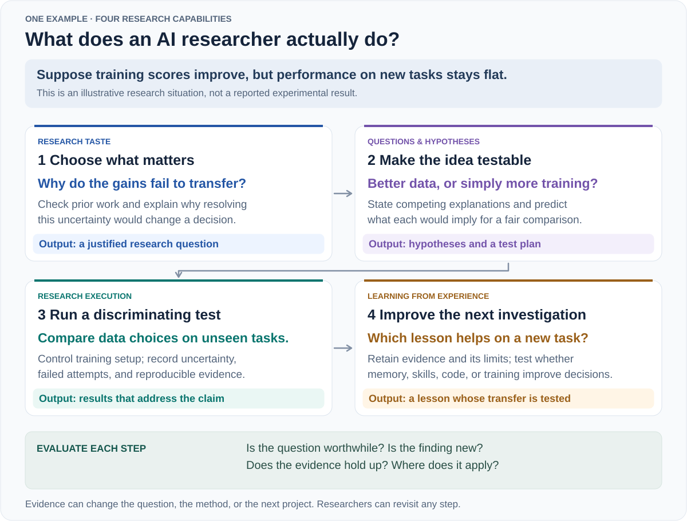
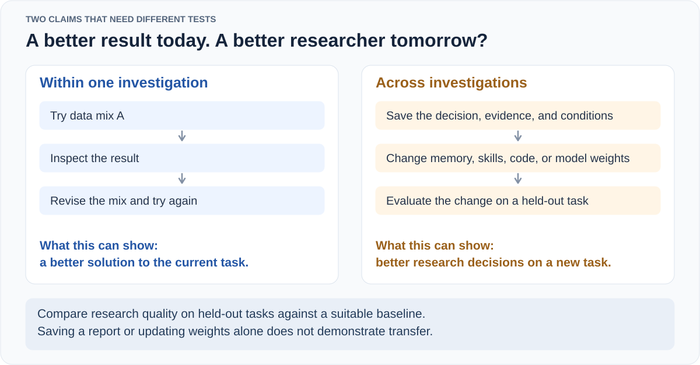

<!-- Generated by scripts/build.mjs from this template and data/*.json. -->
# Awesome Autoresearch

**Learning to ask better questions, run better experiments, and learn from research.**

[English](README.md) | [简体中文](README.zh-CN.md)

[](#collection) [](LICENSE) [](https://github.com/AutoResearching/Awesome-Autoresearch/actions/workflows/validate.yml)

A collection of **papers, code, benchmarks, and essays on how AI does research**: choosing important questions, developing ideas, testing them, and learning from the results.

**82 resources · 75 paper records · 6 essays and talks · 62 official code links**

[Research map](#research-map) · [Browse the collection](#collection) · [Research opportunities](#research-opportunities) · [Reading paths](#reading-paths) · [Suggest a resource](https://github.com/AutoResearching/Awesome-Autoresearch/issues/new?template=suggest-resource.yml)

**Survey:** [English PDF](output/pdf/autoresearch-survey-en.pdf) · [中文 PDF](output/pdf/autoresearch-survey-zh.pdf). Covers the 79 works collected by 26 October 2026.

Sources checked: 2026-10-24–2026-10-30. Entries are grouped by research topic, not ranked.

## Scope

We study **how to do better research**. AI research is the main testbed, with mathematics as another useful setting. We also include work from other fields when its methods help answer the questions below.

We care about **research quality**: Is the question important? Is the contribution new? Does the evidence support the conclusion? When does the result hold? A negative result can be valuable if it rules out an explanation or guides the next study.

Here, *autoresearch* covers AI research assistants, individual research skills, and systems that carry out a whole study. Karpathy's autoresearch is one example.

## Research map

A model's training scores improve, but its performance on new tasks stays flat. What should an AI researcher do next?



This example explains the four abilities; it is not a reported experiment. **A question asks what we want to know. A hypothesis gives a possible explanation. A method describes how to investigate or solve the problem.** We evaluate the importance of the question, what is new, and how well the evidence supports the result. AI scientist systems combine these abilities.

<a id="collection"></a>

### Browse by research capability

| Explore the collection | Entries |
| --- | ---: |
| [Research Taste and Problem Selection](#taste) | 8 |
| [Question Formulation and Hypothesis Generation](#questions) | 16 |
| [Scientific Reasoning and Research Execution](#execution) | 11 |
| [Learning from Research Experience](#learning) | 18 |
| [Benchmarks and Evaluation](#evaluation) | 17 |
| [Integrated AI Scientist Systems](#systems) | 6 |
| [Essays on Research Taste and Scientific Practice](#perspectives) | 6 |

[Research opportunities](#research-opportunities) · [Learning mechanisms](#learning-mechanisms) · [Choosing a testbed](#choosing-a-testbed) · [Reading paths](#reading-paths)

## Research Taste and Problem Selection

<a id="taste"></a>

Which questions are worth studying? Can AI learn to choose them?

| Work | Contribution / idea | Sources |
| --- | --- | --- |
| <a id="work-ai-can-learn-scientific-taste"></a>**Scientific Taste / RLCF**<br><sub>2026 · arXiv</sub> | Learns a Scientific Judge from field- and time-matched citation preferences, then uses its rewards to train a Scientific Thinker for follow-up idea generation. | [Paper](https://arxiv.org/abs/2603.14473) · [Code](https://github.com/tongjingqi/AI-Can-Learn-Scientific-Taste) · [Project](https://tongjingqi.github.io/AI-Can-Learn-Scientific-Taste/) |
| <a id="work-hindsight"></a>**HindSight**<br><sub>2026 · arXiv</sub> | Proposes retrospective evaluation by matching generated ideas to later publications and weighting matches using citations and venue acceptance. | [Paper](https://arxiv.org/abs/2603.15164) |
| <a id="work-innoeval"></a>**InnoEval**<br><sub>2026 · ICML 2026</sub> | Retrieves evidence and uses several reviewer perspectives to assess an idea's novelty, feasibility, and significance, with reasons for the judgments. | [Paper](https://arxiv.org/abs/2602.14367) · [Code](https://github.com/zjunlp/InnoEval) |
| <a id="work-rinobench"></a>**RINoBench**<br><sub>2026 · LREC 2026</sub> | Checks novelty scores and their explanations against expert judgments, testing research-idea evaluation as a separate capability. | [Paper](https://aclanthology.org/2026.lrec-1.370/) · [Code](https://github.com/TimSchopf/RINoBench) |
| <a id="work-opennovelty"></a>**OpenNovelty**<br><sub>2026 · arXiv</sub> | Extracts a paper's contribution claims, searches prior work, and compares full texts to produce a novelty report with traceable evidence. | [Paper](https://arxiv.org/abs/2601.01576) · [Code](https://github.com/january-blue/OpenNovelty) · [Project](https://opennovelty.org/) |
| <a id="work-scistylebench"></a>**SciStyleBench**<br><sub>2026 · arXiv</sub> | Uses controlled changes to idea presentation and substance to test whether LLM judges reward scientific content or persuasive writing style. | [Paper](https://arxiv.org/abs/2608.01666) |
| <a id="work-tasteval"></a>**TasteVal**<br><sub>2026 · arXiv</sub> | Evaluates iterative experiment design and result interpretation on AI R&amp;D tasks while using a fixed coding agent to separate research decisions from implementation. | [Paper](https://arxiv.org/abs/2610.06824) · [Project](https://pzeroresearch.com/work/tasteval/) |
| <a id="work-ideation-execution-gap"></a>**Ideation-Execution Gap**<br><sub>2025 · ICLR 2026</sub> | Has researchers execute human- and LLM-generated ideas and compares expert assessments before and after execution, connecting proposal quality to realized research outcomes. | [Paper](https://arxiv.org/abs/2506.20803) · [Code](https://github.com/NoviScl/AI-Researcher) |

<details>
<summary>Full titles and evidence limits (8)</summary>

- **Scientific Taste / RLCF** — *AI Can Learn Scientific Taste*. Method · Preprint / report. Citations operationalize community reception, not scientific value itself; generated ideas are mainly evaluated by LLM judges and are not experimentally validated.
- **HindSight** — *HindSight: Evaluating LLM-Generated Research Ideas via Future Impact*. Benchmark · Preprint / report. Publication matching is an impact proxy that can undervalue unexplored ideas; the stated model knowledge cutoff is later than the retrieval cutoff, so temporal leakage is not excluded.
- **InnoEval** — *InnoEval: On Research Idea Evaluation as a Knowledge-Grounded, Multi-Perspective Reasoning Problem*. Method · Published. Agreement with human reviews tests the evaluator. It does not establish experimental success, long-term scientific value, or autonomous question selection.
- **RINoBench** — *Is This Idea Novel? An Automated Benchmark for Judgment of Research Ideas*. Benchmark · Published. Agreement with novelty judgments is distinct from generating new questions, predicting feasibility, or demonstrating scientific importance; plausible rationales need not imply correct judgments.
- **OpenNovelty** — *OpenNovelty: An LLM-powered Agentic System for Verifiable Scholarly Novelty Assessment*. System · Preprint / report. Assesses novelty of supplied manuscripts rather than generating questions or estimating scientific importance; conclusions remain limited by retrieval coverage and model judgments.
- **SciStyleBench** — *Style Wins, Substance Loses: A Diagnosis of LLM-as-Judge in Idea Generation*. Benchmark · Preprint / report. Measures evaluator robustness and ranking bias under constructed perturbations; it does not establish the long-term scientific value of the evaluated ideas.
- **TasteVal** — *TasteVal: Measuring the Experimental Research Taste of AI Systems Against Human Experts*. Benchmark · Preprint / report. Measures experimental compute efficiency on assigned problems. It does not measure open-ended problem selection, and the tasks are not publicly released.
- **Ideation-Execution Gap** — *The Ideation-Execution Gap: Execution Outcomes of LLM-Generated versus Human Research Ideas*. Study · Published. Execution is human-led and outcomes are assessed within an NLP research study; this is evidence about idea evaluation, not a demonstration of autonomous research execution.

</details>

## Question Formulation and Hypothesis Generation

<a id="questions"></a>

How can AI find important questions and propose ideas we can test?

| Work | Contribution / idea | Sources |
| --- | --- | --- |
| <a id="work-agentideabench"></a>**AgentIdeaBench**<br><sub>2026 · arXiv</sub> | Compares hypothesis generation from supplied references with agent-led literature search. Uses the same subfields, output format, and critics, which retrieve prior work before scoring. | [Paper](https://arxiv.org/abs/2609.07611) · [Code](https://github.com/HKUST-KnowComp/AgentIdeaBench) |
| <a id="work-rq-bench"></a>**RQ-Bench**<br><sub>2026 · arXiv</sub> | Builds reference research questions from papers and their cited backgrounds. Compares generated questions using standalone LLM scores, pairwise judgments, and blinded expert review. | [Paper](https://arxiv.org/abs/2606.12071) · [Project](https://huggingface.co/datasets/declare-lab/rq-bench) |
| <a id="work-llm-novel-research-ideas-human-study"></a>**Human Study of Research Ideation**<br><sub>2024 · ICLR 2025</sub> | Compares LLM-generated research proposals with expert-written ideas through blinded expert review and examines generation diversity and self-evaluation failures. | [Paper](https://arxiv.org/abs/2409.04109) · [Code](https://github.com/NoviScl/AI-Researcher) |
| <a id="work-chain-of-ideas"></a>**Chain of Ideas / Idea Arena**<br><sub>2024 · Findings of EMNLP 2025</sub> | Organizes literature into chains of research developments to generate ideas and experiment designs, and introduces Idea Arena for comparative proposal evaluation. | [Paper](https://aclanthology.org/2025.findings-emnlp.477/) · [Code](https://github.com/DAMO-NLP-SG/CoI-Agent) |
| <a id="work-liveideabench"></a>**LiveIdeaBench**<br><sub>2024 · Nature Communications 2026</sub> | Asks models to generate scientific ideas from short keyword prompts. A changing LLM panel scores originality, feasibility, fluency, flexibility, and clarity. | [Paper](https://www.nature.com/articles/s41467-026-70245-1) · [Code](https://github.com/x66ccff/liveideabench) · [Project](https://liveideabench.com/) |
| <a id="work-hypogenic"></a>**HypoGeniC**<br><sub>2024 · NLP4Science 2024</sub> | Generates hypotheses from labeled examples. Uses prediction errors and bandit-inspired selection to expand and revise a hypothesis bank. | [Paper](https://aclanthology.org/2024.nlp4science-1.10/) · [Code](https://github.com/ChicagoHAI/hypothesis-generation) |
| <a id="work-ideabench"></a>**IdeaBench**<br><sub>2024 · arXiv</sub> | Benchmarks idea generation from published papers' reference contexts and uses GPT-4o rankings to score selected criteria such as novelty and feasibility. | [Paper](https://arxiv.org/abs/2411.02429) · [Code](https://github.com/amir-hassan25/IdeaBench) |
| <a id="work-ideasynth"></a>**IdeaSynth**<br><sub>2024 · CHI 2025</sub> | Lets users revise and combine an idea's problem, solution, evaluation, and contribution with feedback from the literature. | [Paper](https://arxiv.org/abs/2410.04025) |
| <a id="work-hyporefine"></a>**HypoRefine / Literature Meets Data**<br><sub>2024 · ACL 2025</sub> | Combines knowledge from the literature with hypotheses generated and refined from data. Tests their predictions and their usefulness for human decisions. | [Paper](https://aclanthology.org/2025.acl-long.12/) · [Code](https://github.com/ChicagoHAI/hypothesis-generation) |
| <a id="work-researchagent"></a>**ResearchAgent**<br><sub>2024 · NAACL 2025</sub> | Starts from a seed paper, an academic graph, and an entity knowledge store. Generates problems, methods, and experiment plans, then revises them with reviewing agents. | [Paper](https://aclanthology.org/2025.naacl-long.342/) · [Code](https://github.com/JinheonBaek/ResearchAgent) |
| <a id="work-sciagents"></a>**SciAgents**<br><sub>2024 · Advanced Materials 2025</sub> | Uses a knowledge graph and specialist agents to connect distant concepts, then generate, critique, and refine hypotheses across disciplines. | [Paper](https://doi.org/10.1002/adma.202413523) · [Code](https://github.com/lamm-mit/SciAgentsDiscovery) |
| <a id="work-scideator"></a>**Scideator**<br><sub>2024 · ACM CAIS 2026</sub> | Helps people form ideas by recombining papers' purposes, mechanisms, and evaluation methods. Checks proposed novelty against the literature. | [Paper](https://arxiv.org/abs/2409.14634) |
| <a id="work-scipip"></a>**SciPIP**<br><sub>2024 · arXiv</sub> | Retrieves papers through semantic, keyword, and citation search. Combines brainstorming with retrieval-based generation to propose ideas for a supplied background. | [Paper](https://arxiv.org/abs/2410.23166) · [Code](https://github.com/cheerss/SciPIP) |
| <a id="work-coquest"></a>**CoQuest**<br><sub>2023 · CHI 2024</sub> | Studies how breadth-first and depth-first question generation affect researchers' exploration, reflection, and control when working with an LLM. | [Paper](https://arxiv.org/abs/2310.06155) · [Code](https://github.com/yiren-liu/coquest) |
| <a id="work-moose"></a>**MOOSE**<br><sub>2023 · Findings of ACL 2024</sub> | Extracts backgrounds and inspirations from web texts, then uses several forms of feedback to generate and refine social-science hypotheses. | [Paper](https://aclanthology.org/2024.findings-acl.804/) · [Code](https://github.com/ZonglinY/MOOSE) |
| <a id="work-scimon"></a>**SciMON**<br><sub>2023 · ACL 2024</sub> | Retrieves research inspirations for a supplied background, then repeatedly compares ideas with prior work and revises them. | [Paper](https://aclanthology.org/2024.acl-long.18/) · [Code](https://github.com/EagleW/Scientific-Inspiration-Machines-Optimized-for-Novelty) |

<details>
<summary>Full titles and evidence limits (16)</summary>

- **AgentIdeaBench** — *AgentIdeaBench: Benchmarking Scientific Ideation in the Agent Era*. Benchmark · Preprint / report. Active exploration also changes sequential reasoning and information access. Scores remain model judgments, with limited expert validation; the generated hypotheses are not experimentally verified discoveries.
- **RQ-Bench** — *On the Limits of LLM-as-Judge for Scientific Novelty Assessment*. Benchmark · Preprint / report. Author-anchored questions are reference points, not the only valid questions. Expert and model novelty judgments disagree; proposal feasibility, execution outcomes, and scientific importance are not established by these scores.
- **Human Study of Research Ideation** — *Can LLMs Generate Novel Research Ideas? A Large-Scale Human Study with 100+ NLP Researchers*. Study · Published. The main evidence concerns perceived novelty and feasibility of NLP proposals before execution; expert preference is not proof of successful discoveries or downstream scientific value.
- **Chain of Ideas / Idea Arena** — *Chain of Ideas: Revolutionizing Research Via Novel Idea Development with LLM Agents*. Method · Published. Comparative proposal ratings measure judged idea quality; they do not demonstrate executed discoveries, and organizing past literature is not itself learning from new experiments.
- **LiveIdeaBench** — *Evaluating LLMs' divergent thinking capabilities for scientific idea generation with minimal context*. Benchmark · Published. Brainstorming and judge ratings do not establish which questions are worth pursuing or yield discoveries; changing the judge panel also complicates comparisons over time.
- **HypoGeniC** — *Hypothesis Generation with Large Language Models*. Method · Published. Held-out predictive accuracy tests whether hypotheses capture useful dataset patterns; it does not establish causal explanations or the broader scientific importance of the questions.
- **IdeaBench** — *IdeaBench: Benchmarking Large Language Models for Research Idea Generation*. Benchmark · Preprint / report. Its relative scores measure judged proposal quality against a reference set; they do not demonstrate experimental success, causal validity, or realized scientific value.
- **IdeaSynth** — *IdeaSynth: Iterative Research Idea Development Through Evolving and Composing Idea Facets with Literature-Grounded Feedback*. System · Published. User studies measure support for exploring and developing proposals; they do not demonstrate autonomous question selection or scientifically validated outcomes.
- **HypoRefine / Literature Meets Data** — *Literature Meets Data: A Synergistic Approach to Hypothesis Generation*. Method · Published. Evidence comes from classification and decision-support tasks, including deception and AI-content detection; predictive utility is not causal validation or open-ended scientific discovery.
- **ResearchAgent** — *ResearchAgent: Iterative Research Idea Generation over Scientific Literature with Large Language Models*. Method · Published. Evidence is based on human and model evaluations of generated proposals; producing an experiment design is not the same as executing and validating it.
- **SciAgents** — *SciAgents: Automating Scientific Discovery Through Bioinspired Multi-Agent Intelligent Graph Reasoning*. System · Published. Demonstrations focus on bioinspired materials ideas; proposed mechanisms and predicted properties are starting points for research, not experimentally established discoveries or evidence of transfer to AI research.
- **Scideator** — *Scideator: Human-LLM Compound System for Scientific Ideation through Facet Recombination and Novelty Evaluation*. System · Published. User studies and novelty-checker ablations evaluate this human–AI tool. They do not establish autonomous discovery or realized scientific impact.
- **SciPIP** — *SciPIP: An LLM-based Scientific Paper Idea Proposer*. Method · Preprint / report. Evaluation uses expert ratings of NLP and computer-vision proposals; perceived feasibility and helpfulness are not evidence that the proposals were successfully executed.
- **CoQuest** — *CoQuest: Exploring Research Question Co-Creation with an LLM-based Agent*. System · Published. Evidence concerns HCI researchers' ideation experience and perceived creativity; it does not establish the questions' eventual scientific importance or autonomous research success.
- **MOOSE** — *Large Language Models for Automated Open-domain Scientific Hypotheses Discovery*. Method · Published. Expert and GPT-based judgments assess proposed hypotheses; judgments of novelty or plausibility do not substitute for experiments establishing that the hypotheses are true.
- **SciMON** — *SciMON: Scientific Inspiration Machines Optimized for Novelty*. Method · Published. Novelty-oriented proposal generation is conditioned on supplied contexts; novelty relative to retrieved literature does not establish experimental validity or research importance.

</details>

## Scientific Reasoning and Research Execution

<a id="execution"></a>

How can AI design experiments, check explanations, and reach reliable conclusions?

| Work | Contribution / idea | Sources |
| --- | --- | --- |
| <a id="work-autoresearch"></a>**Karpathy's autoresearch**<br><sub>2026 · Open-source project</sub> | A compact modify-train-evaluate-retain loop for single-GPU language-model training, useful as an accessible research execution baseline. | [Code](https://github.com/karpathy/autoresearch) |
| <a id="work-arbor"></a>**Arbor**<br><sub>2026 · arXiv</sub> | Stores hypotheses, experimental artifacts, evidence, and reusable lessons in a persistent tree managed by a coordinator and isolated executors. | [Paper](https://arxiv.org/abs/2606.11926) · [Code](https://github.com/RUC-NLPIR/Arbor) · [Project](https://RUC-NLPIR.github.io/Arbor/) |
| <a id="work-aletheia"></a>**Aletheia**<br><sub>2026 · arXiv</sub> | Iterates generation, verification, revision, and literature use for research-level mathematics; also discusses autonomy, novelty, and human contribution reporting. | [Paper](https://arxiv.org/abs/2602.10177) · [Resources](https://github.com/google-deepmind/superhuman/tree/main/aletheia) |
| <a id="work-aide"></a>**AIDE**<br><sub>2025 · arXiv</sub> | Treats ML experimentation as tree search over executable code, using measured results to choose whether to draft, debug, or improve candidate solutions. | [Paper](https://arxiv.org/abs/2502.13138) · [Code](https://github.com/WecoAI/aideml) |
| <a id="work-alphaevolve"></a>**AlphaEvolve**<br><sub>2025 · arXiv / technical report</sub> | Evolves algorithm implementations using LLM proposals and automated evaluator feedback across mathematical and computational tasks. | [Paper](https://arxiv.org/abs/2506.13131) · [Project](https://deepmind.google/blog/alphaevolve-a-gemini-powered-coding-agent-for-designing-advanced-algorithms/) |
| <a id="work-popper"></a>**POPPER**<br><sub>2025 · ICML 2025</sub> | Uses agents to design and run tests of a supplied hypothesis's measurable implications. Combines test evidence sequentially using e-values. | [Paper](https://proceedings.mlr.press/v267/huang25n.html) · [Code](https://github.com/snap-stanford/POPPER) |
| <a id="work-curie"></a>**Curie**<br><sub>2025 · arXiv</sub> | Coordinates planning and execution agents to reproduce, extend, or challenge computational findings. Checks the setup, controls task handoffs, and keeps structured experiment records. | [Paper](https://arxiv.org/abs/2502.16069) · [Code](https://github.com/Just-Curieous/Curie) · [Project](https://www.just-curieous.com/) |
| <a id="work-rd-agent"></a>**R&amp;D-Agent**<br><sub>2025 · arXiv</sub> | Separates proposing and evaluating improvement ideas from implementing and debugging them, making the research-and-development loop easier to extend. | [Paper](https://arxiv.org/abs/2505.14738) · [Code](https://github.com/microsoft/RD-Agent) · [Project](https://rdagent.readthedocs.io/en/latest/index.html) |
| <a id="work-autora"></a>**AutoRA**<br><sub>2024 · Journal of Open Source Software 2024</sub> | Connects experiment design, data collection, and scientific model discovery through replaceable experimentalist, experiment-runner, and theorist modules. | [Paper](https://joss.theoj.org/papers/10.21105/joss.06839) · [Code](https://github.com/AutoResearch/autora) · [Project](https://autoresearch.github.io/autora/) |
| <a id="work-funsearch"></a>**FunSearch**<br><sub>2023 · Nature 2023</sub> | Combines LLM program generation, executable evaluation, and evolutionary search for mathematical constructions and algorithms. | [Paper](https://www.nature.com/articles/s41586-023-06924-6) · [Code](https://github.com/google-deepmind/funsearch) |
| <a id="work-deep-adaptive-design"></a>**Deep Adaptive Design (DAD)**<br><sub>2021 · ICML 2021</sub> | Learns a reusable experimental-design policy that maps previous observations to the next experiment and optimizes information gained across the full experiment sequence. | [Paper](https://proceedings.mlr.press/v139/foster21a.html) · [Code](https://github.com/ae-foster/dad) |

<details>
<summary>Full titles and evidence limits (11)</summary>

- **Karpathy's autoresearch** — *autoresearch*. System · Project. Optimizes a fixed metric in short training runs. Research instructions are human-written; metric gains do not demonstrate question selection or learned taste.
- **Arbor** — *Toward Generalist Autonomous Research via Hypothesis-Tree Refinement*. System · Preprint / report. Evaluated mainly as autonomous optimization of supplied artifacts and objectives. Evidence accumulation is not by itself broad scientific question selection.
- **Aletheia** — *Towards Autonomous Mathematics Research*. System · Preprint / report. Uses natural-language reasoning, not universal formal proof checking. The linked release contains prompts and outputs, not the complete agent implementation.
- **AIDE** — *AIDE: AI-Driven Exploration in the Space of Code*. Method · Preprint / report. The goal, data, and optimization metric are supplied, so performance on Kaggle, MLE-bench, and RE-Bench measures execution and search rather than research-question significance.
- **AlphaEvolve** — *AlphaEvolve: A coding agent for scientific and algorithmic discovery*. System · Preprint / report. Requires an executable objective and evaluation procedure. Verified improvements within supplied tasks do not measure the value of self-selected research questions.
- **POPPER** — *Automated Hypothesis Validation with Agentic Sequential Falsifications*. Method · Published. Evaluation uses existing datasets, and Type-I error control depends on valid logical implications and conditional tests; it does not establish false discovery rate control across many hypotheses.
- **Curie** — *Curie: Toward Rigorous and Automated Scientific Experimentation with AI Agents*. Method · Preprint / report. The study supplies questions and context in four computer-science domains. Its combined LLM and human evaluation does not formally guarantee scientific validity or demonstrate autonomous question selection.
- **R&amp;D-Agent** — *R&amp;D-Agent: An LLM-Agent Framework Towards Autonomous Data Science*. Method · Preprint / report. The linked report evaluates ML engineering on MLE-bench. Separate finance and fine-tuning papers in the repository do not establish autonomous scientific question selection for this work.
- **AutoRA** — *AutoRA: Automated Research Assistant for Closed-Loop Empirical Research*. Method · Published. Users specify variables, experimental access, and model-discovery components; the framework does not itself establish autonomous selection of scientifically important questions.
- **FunSearch** — *Mathematical discoveries from program search with large language models*. Method · Published. The objective and evaluator are supplied by humans. Released research code excludes the language model, sandbox, and distributed infrastructure.
- **Deep Adaptive Design (DAD)** — *Deep Adaptive Design: Amortizing Sequential Bayesian Experimental Design*. Method · Published. This is a Bayesian design foundation with a supplied likelihood, prior, and design space, rather than a demonstrated ability to invent new research goals or scientific model classes.

</details>

## Learning from Research Experience

<a id="learning"></a>

What can AI learn from a study that helps it do better research next time?

| Work | Contribution / idea | Sources |
| --- | --- | --- |
| <a id="work-agora"></a>**Agora**<br><sub>2026 · arXiv</sub> | Git records a shared graph of hypotheses, results, and verifications so research agents in separate sessions can reuse and extend collective work. | [Paper](https://arxiv.org/abs/2609.18094) · [Project](https://yifanzhang-pro.github.io/Agora/) |
| <a id="work-autoresearchclaw"></a>**AutoResearchClaw**<br><sub>2026 · arXiv</sub> | Stores lessons from failed research runs, reduces their weight over time, and retrieves them to avoid later mistakes. Human involvement is configurable. | [Paper](https://arxiv.org/abs/2605.20025) · [Code](https://github.com/aiming-lab/AutoResearchClaw) |
| <a id="work-bilevel-autoresearch"></a>**Bilevel Autoresearch**<br><sub>2026 · arXiv</sub> | An outer loop reads search records and rewrites the Python search strategy. This changes how an inner autoresearch loop proposes and evaluates training settings. | [Paper](https://arxiv.org/abs/2603.23420) · [Code](https://github.com/EdwardOptimization/Bilevel-Autoresearch) |
| <a id="work-evolution-fine-tuning"></a>**Evolution Fine-Tuning / Finch**<br><sub>2026 · NeurIPS 2026 (accepted)</sub> | Uses evolutionary search traces from several optimization domains for supervised training of Finch models. Tests transfer to held-out tasks and combination with test-time RL. | [Paper](https://arxiv.org/abs/2606.29082) · [Code](https://github.com/Open-Galapagos/evolution-fine-tuning) · [Project](https://open-galapagos.github.io/evolution_finetuning/) |
| <a id="work-evoscientist"></a>**EvoScientist**<br><sub>2026 · arXiv</sub> | An evolution manager turns completed research traces into lasting idea and experiment memories. Researcher and engineer agents retrieve them for later tasks. | [Paper](https://arxiv.org/abs/2603.08127) · [Code](https://github.com/EvoScientist/EvoScientist) |
| <a id="work-hypoforge"></a>**HypoForge**<br><sub>2026 · arXiv</sub> | Uses comparative critique and execution feedback to improve reusable hypothesis-generation and testing skills. Tests those skills on held-out tasks without fine-tuning the base model. | [Paper](https://arxiv.org/abs/2608.25770) |
| <a id="work-internagent-1-5"></a>**InternAgent-1.5**<br><sub>2026 · arXiv</sub> | Reuses research experience through strategy memory, experiment records within a run, and knowledge retained across sessions. Links generation, verification, and evolution in long research workflows. | [Paper](https://arxiv.org/abs/2602.08990) · [Code](https://github.com/InternScience/InternAgent) |
| <a id="work-researchtrails"></a>**ResearchTrails**<br><sub>2026 · arXiv</sub> | Extracts researchers' decisions from Git histories. Compares using examples and distilled skills at inference time with SFT and RL for choosing the next research action. | [Paper](https://arxiv.org/abs/2610.07184) · [Code](https://github.com/xuchengong/ResearchTrails) · [Project](https://researchtrails.org/blog/) |
| <a id="work-ttt-discover"></a>**TTT-Discover**<br><sub>2026 · ICML 2026</sub> | Updates model weights with RL while searching for a solution to one problem. Uses continuous rewards in mathematics, kernels, algorithms, and biological data analysis. | [Paper](https://proceedings.mlr.press/v306/yuksekgonul26a.html) · [Code](https://github.com/test-time-training/discover) · [Project](https://test-time-training.github.io/discover/) |
| <a id="work-mle-ideator"></a>**MLE-Ideator**<br><sub>2026 · EACL 2026 (Short Papers)</sub> | Separates idea generation from implementation. Trains the ideator with RL rewards from execution results and tests its guidance on held-out ML engineering tasks. | [Paper](https://aclanthology.org/2026.eacl-short.32/) |
| <a id="work-or-agent"></a>**OR-Agent**<br><sub>2026 · arXiv</sub> | Uses tree search and backtracking to improve heuristics. Reflections, result summaries, and accumulated lessons guide later branches within the same optimization run. | [Paper](https://arxiv.org/abs/2602.13769) · [Code](https://github.com/qiliuchn/OR-Agent) |
| <a id="work-scisense"></a>**SciSense**<br><sub>2026 · arXiv</sub> | Builds structured ideation traces grounded in cited papers and uses them for supervised training of research-planning models. Compares reconstructing known contributions with generating new research ideas. | [Paper](https://arxiv.org/abs/2605.00557) · [Code](https://github.com/minnesotanlp/SciSense) |
| <a id="work-agentrxiv"></a>**AgentRxiv**<br><sub>2025 · arXiv</sub> | Agent laboratories retrieve and publish research reports through shared memory, building on earlier reasoning and prompting experiments across research runs. | [Paper](https://arxiv.org/abs/2503.18102) · [Code](https://github.com/SamuelSchmidgall/AgentLaboratory) · [Project](https://agentrxiv.github.io/) |
| <a id="work-dolphin"></a>**Dolphin**<br><sub>2025 · ACL 2025</sub> | Connects idea generation, code implementation, and experimental analysis in a loop that feeds previous results into the next research iteration. | [Paper](https://aclanthology.org/2025.acl-long.1056/) · [Code](https://github.com/InternScience/Dolphin) · [Project](https://alpha-innovator.github.io/Dolphin-project-page/) |
| <a id="work-cycleresearcher"></a>**CycleResearcher**<br><sub>2024 · ICLR 2025</sub> | Uses iterative preference training with a research-generation policy and an automated reviewer to improve research planning and manuscript generation. | [Paper](https://arxiv.org/abs/2411.00816) · [Code](https://github.com/zhu-minjun/Researcher) |

<details>
<summary>Full titles and evidence limits (15)</summary>

- **Agora** — *Agora: Git as Shared Memory for Collective AutoResearch*. System · Preprint / report. The weight-transfer case study documents reuse and verification; the paper says a matched comparison is needed to establish discovery gains per compute. Shared state is not model training.
- **AutoResearchClaw** — *AutoResearchClaw: Self-Reinforcing Autonomous Research with Human-AI Collaboration*. System · Preprint / report. It reuses external lessons without training the model. Ablations mainly show fewer known failures, not evidence of a higher scientific-quality ceiling or learned judgment of research importance.
- **Bilevel Autoresearch** — *Bilevel Autoresearch: Meta-Autoresearching Itself*. Method · Preprint / report. Evidence comes from a small repeated study of one GPT pretraining task. It changes search code, not model weights; cross-task transfer and unbounded recursive improvement are not demonstrated.
- **Evolution Fine-Tuning / Finch** — *Evolution Fine-Tuning: Learning to Discover Across 371 Optimization Tasks*. Method · Preprint / report. Training transfers across tasks with supplied objectives and evaluators; this does not show that the model learns question importance. Data collection and main evaluations use one search framework, so broad transfer across research workflows is not established.
- **EvoScientist** — *EvoScientist: Towards Multi-Agent Evolving AI Scientists for End-to-End Scientific Discovery*. System · Preprint / report. Adaptation comes from reusing stored strategies, not training the base model. Idea ratings and execution results do not establish general judgment of scientific importance.
- **HypoForge** — *HypoForge: A Self-Improving Multi-Agent Framework for Automated Hypothesis Generation and Testing via Scientific Skill Learning*. Method · Preprint / report. The test-pass metric rewards successful execution and p &lt; 0.05 for reference hypotheses; this alone establishes neither false-positive control nor scientific importance. Adaptation does not update backbone weights.
- **InternAgent-1.5** — *InternAgent-1.5: A Unified Agentic Framework for Long-Horizon Autonomous Scientific Discovery*. System · Preprint / report. Memory supports both adaptation within a run and reuse across runs. The results do not isolate cross-domain strategy transfer or show that weight updates teach the base model research taste.
- **ResearchTrails** — *Learning Scientific Exploration from Human Research Decision Trajectories*. Method · Preprint / report. Git commits capture only part of research experience. Evaluation mainly checks similarity to recorded decisions, not whether the learned policy produces important new discoveries.
- **TTT-Discover** — *Learning to Discover at Test Time*. Method · Published. The objective and evaluator are supplied. Task-specific test-time training does not establish retained gains on new tasks or the ability to choose important research questions.
- **MLE-Ideator** — *Learning to Ideate for Machine Learning Engineering Agents*. Method · Published. Tasks have supplied MLE-Bench goals. Results test transfer of engineering guidance, not valuable question selection. The reported evaluation omits high-complexity tasks.
- **OR-Agent** — *OR-Agent: Bridging Evolutionary Search and Structured Research for Automated Heuristic Design*. Method · Preprint / report. Tests use specified combinatorial and simulation optimization tasks. Verbal gradients and momentum describe reflection, not weight updates; cross-task research-strategy transfer is not established.
- **SciSense** — *Structure Liberates: How Constrained Sensemaking Produces More Novel Research Output*. Method · Preprint / report. The traces are synthetic, not recordings of human reasoning. Novelty ratings and a small computer-science execution study do not establish general scientific value. Released code covers SFT and evaluation, but not the exploratory RL experiments.
- **AgentRxiv** — *AgentRxiv: Towards Collaborative Autonomous Research*. System · Preprint / report. Evidence concerns cumulative progress on a specified benchmark objective; report reuse does not establish learned scientific taste or general cross-domain research strategy.
- **Dolphin** — *Dolphin: Moving Towards Closed-loop Auto-research through Thinking, Practice, and Feedback*. System · Published. Feedback improves search within a supplied topic; it does not by itself demonstrate cross-task learning of research strategies, model-weight updates, or learned scientific taste.
- **CycleResearcher** — *CycleResearcher: Improving Automated Research via Automated Review*. Method · Published. Main results measure generated manuscripts and review scores. The model generates experimental results without running the experiments. An appendix adds an external executor, but execution is outside the core method.

</details>

### Related methods

These methods may help build research agents. Their original tests do not directly measure scientific discovery or research taste.

| Work | Contribution / idea | Sources |
| --- | --- | --- |
| <a id="work-darwin-godel-machine"></a>**Darwin Gödel Machine**<br><sub>2025 · ICLR 2026</sub> | Maintains an evolving archive of coding agents that modify their own code and assess resulting variants through empirical coding benchmarks. | [Paper](https://arxiv.org/abs/2505.22954) · [Code](https://github.com/jennyzzt/dgm) |
| <a id="work-adas"></a>**ADAS**<br><sub>2024 · ICLR 2025</sub> | A meta-agent searches over agent programs using an archive of prior designs and evaluations, with transfer tests across tasks and foundation models. | [Paper](https://arxiv.org/abs/2408.08435) · [Code](https://github.com/ShengranHu/ADAS) · [Project](https://www.shengranhu.com/ADAS/) |
| <a id="work-reflexion"></a>**Reflexion**<br><sub>2023 · NeurIPS 2023</sub> | Stores verbal reflections on task feedback in episodic memory to guide subsequent trials without updating model weights. | [Paper](https://arxiv.org/abs/2303.11366) · [Code](https://github.com/noahshinn/reflexion) |

<details>
<summary>Full titles and evidence limits (3)</summary>

- **Darwin Gödel Machine** — *Darwin Gödel Machine: Open-Ended Evolution of Self-Improving Agents*. Foundation · Published. Demonstrates agent self-improvement in coding. Benchmark gains are not a formal guarantee that self-modification helps, or evidence of scientific taste.
- **ADAS** — *Automated Design of Agentic Systems*. Foundation · Published. A foundation for improving agent workflows against specified task objectives; benchmark transfer does not establish the ability to choose important scientific questions.
- **Reflexion** — *Reflexion: Language Agents with Verbal Reinforcement Learning*. Foundation · Published. Evaluated on decision-making, coding, and reasoning tasks. It supports inference-time adaptation but is not direct evidence of scientific discovery or learned research taste.

</details>

## Benchmarks and Evaluation

<a id="evaluation"></a>

Is the question important? Is the contribution new? Does the evidence support it, and when does it hold?

| Work | Contribution / idea | Sources |
| --- | --- | --- |
| <a id="work-airs-bench"></a>**AIRS-Bench**<br><sub>2026 · arXiv</sub> | Asks agents to solve ML tasks drawn from papers without baseline code. Tests idea generation, experiment analysis, and iterative improvement across domains. | [Paper](https://arxiv.org/abs/2602.06855) · [Code](https://github.com/facebookresearch/airs-bench) |
| <a id="work-fml-bench"></a>**FML-bench**<br><sub>2026 · arXiv</sub> | Uses shared execution tools to compare how research agents explore and improve solutions. Separates search strategy from execution infrastructure and records the research process. | [Paper](https://arxiv.org/abs/2605.17373) · [Code](https://github.com/qrzou/FML-bench) |
| <a id="work-many-ai-analysts-one-dataset"></a>**Many AI Analysts, One Dataset**<br><sub>2026 · PNAS 2026</sub> | Compares autonomous analyses of the same dataset and hypothesis across models and personas. Shows how analysis choices change conclusions and motivates reporting alternative analyses. | [Paper](https://www.pnas.org/doi/10.1073/pnas.2606495123) · [Code](https://github.com/amazon-science/agentic-forking-path) |
| <a id="work-posttrainbench"></a>**PostTrainBench**<br><sub>2026 · arXiv</sub> | Gives agents a base language model and target benchmark, with ten hours on one H100 to improve performance through data curation, method choice, and experiments. | [Paper](https://arxiv.org/abs/2603.08640) · [Code](https://github.com/aisa-group/PostTrainBench) · [Project](https://posttrainbench.com/) |
| <a id="work-mlgym"></a>**MLGym**<br><sub>2025 · COLM 2025</sub> | Provides research tasks in vision, language, reinforcement learning, and games through a Gym-style interface. Supports agent evaluation and learning algorithms for research behavior. | [Paper](https://arxiv.org/abs/2502.14499) · [Code](https://github.com/facebookresearch/MLGym) · [Project](https://sites.google.com/view/mlgym) |
| <a id="work-mlr-bench"></a>**MLR-Bench**<br><sub>2025 · NeurIPS 2025 Datasets and Benchmarks</sub> | Uses workshop research topics to evaluate ideas, proposals, experiments, and papers with MLR-Judge, assessing research outputs beyond a single prediction score. | [Paper](https://arxiv.org/abs/2505.19955) · [Code](https://github.com/chchenhui/mlrbench) · [Project](https://chchenhui.github.io/mlrbench/) |
| <a id="work-paperbench"></a>**PaperBench**<br><sub>2025 · ICML 2025</sub> | Tests whether agents can reproduce ML papers: implement the method, run it, and match the results. Authors help define the rubrics; the automated judge is also evaluated. | [Paper](https://arxiv.org/abs/2504.01848) · [Code](https://github.com/openai/frontier-evals/tree/main/project/paperbench) · [Project](https://openai.com/index/paperbench/) |
| <a id="work-core-bench"></a>**CORE-Bench**<br><sub>2024 · TMLR 2025</sub> | Evaluates computational reproducibility through installing dependencies, executing supplied scientific code, and interpreting its numerical or visual outputs. | [Paper](https://arxiv.org/abs/2409.11363) · [Code](https://github.com/siegelz/core-bench) · [Project](https://hal.cs.princeton.edu/corebench_hard) |
| <a id="work-discoverybench"></a>**DiscoveryBench**<br><sub>2024 · ICLR 2025</sub> | Tests hypothesis search and verification on real and synthetic datasets. Scores the components of discovered relationships, going beyond whether code runs. | [Paper](https://arxiv.org/abs/2407.01725) · [Code](https://github.com/allenai/discoverybench) |
| <a id="work-discoveryworld"></a>**DiscoveryWorld**<br><sub>2024 · NeurIPS 2024 Datasets and Benchmarks</sub> | A simulated environment evaluates cycles of hypothesis formation, intervention, experimentation, and explanation, including discovered knowledge alongside task completion. | [Paper](https://arxiv.org/abs/2406.06769) · [Code](https://github.com/allenai/discoveryworld) · [Project](https://allenai.github.io/discoveryworld/) |
| <a id="work-frontiermath"></a>**FrontierMath**<br><sub>2024 · arXiv</sub> | Tests difficult mathematical reasoning and computational investigation on expert-written problems with automatically checkable answers. | [Paper](https://arxiv.org/abs/2411.04872) · [Project](https://epoch.ai/frontiermath/tiers-1-4/the-benchmark) |
| <a id="work-mle-bench"></a>**MLE-bench**<br><sub>2024 · ICLR 2025</sub> | Tests data preparation, model training, and experiment iteration on Kaggle tasks. Includes human competition baselines and analyses of compute scaling and data contamination. | [Paper](https://arxiv.org/abs/2410.07095) · [Code](https://github.com/openai/mle-bench) · [Project](https://openai.com/index/mle-bench/) |
| <a id="work-re-bench"></a>**RE-Bench**<br><sub>2024 · ICML 2025</sub> | Provides AI research engineering tasks and expert human attempts. Compares agent performance, search strategies, and the gains from additional time. | [Paper](https://arxiv.org/abs/2411.15114) · [Code](https://github.com/METR/RE-Bench) |
| <a id="work-scicode"></a>**SciCode**<br><sub>2024 · NeurIPS 2024 Datasets and Benchmarks</sub> | Measures whether models can combine scientific knowledge, reasoning, and executable code on scientist-curated research problems with testable subproblems. | [Paper](https://arxiv.org/abs/2407.13168) · [Code](https://github.com/scicode-bench/SciCode) · [Project](https://scicode-bench.github.io/) |
| <a id="work-scienceagentbench"></a>**ScienceAgentBench**<br><sub>2024 · ICLR 2025</sub> | Tests generated programs on expert-checked tasks from published science. Uses execution results to assess reliability and separately records cost. | [Paper](https://arxiv.org/abs/2410.05080) · [Code](https://github.com/OSU-NLP-Group/ScienceAgentBench) · [Project](https://osu-nlp-group.github.io/ScienceAgentBench/) |
| <a id="work-mlagentbench"></a>**MLAgentBench**<br><sub>2023 · ICML 2024</sub> | Lets agents inspect files, run experiments, and improve ML models in an executable testbed. The records support analysis of planning and experimentation. | [Paper](https://arxiv.org/abs/2310.03302) · [Code](https://github.com/snap-stanford/MLAgentBench) |
| <a id="work-scienceworld"></a>**ScienceWorld**<br><sub>2022 · EMNLP 2022</sub> | Tests action-grounded scientific reasoning by requiring agents to conduct experiments and complete tasks in an interactive text environment. | [Paper](https://aclanthology.org/2022.emnlp-main.775/) · [Code](https://github.com/allenai/ScienceWorld) · [Project](https://sciworld.apps.allenai.org/) |

<details>
<summary>Full titles and evidence limits (17)</summary>

- **AIRS-Bench** — *AIRS-Bench: a Suite of Tasks for Frontier AI Research Science Agents*. Benchmark · Preprint / report. Each task supplies a problem, dataset, and metric; exceeding a reference score does not demonstrate autonomous problem discovery or scientific significance.
- **FML-bench** — *FML-bench: A Controlled Study of AI Research Agent Strategies from the Perspective of Search Dynamics*. Benchmark · Preprint / report. Agents improve supplied baseline code on fixed tasks; the 2026 main-branch version differs from the 2025 legacy benchmark and should not be conflated with it.
- **Many AI Analysts, One Dataset** — *Many AI analysts, one dataset: Navigating the agentic data science multiverse*. Study · Published. The hypothesis and estimand are fixed across three datasets, and an AI auditor checks the analyses. This reveals analytic variation, not proof that every retained analysis is correct or that agents can choose worthwhile questions.
- **PostTrainBench** — *PostTrainBench: Can LLM Agents Automate LLM Post-Training?*. Benchmark · Preprint / report. Base models and target benchmarks are supplied, so results measure bounded post-training rather than question selection. Leaderboard versions change scoring and integrity rules; official instruct-model baselines are not compute-matched.
- **MLGym** — *MLGym: A New Framework and Benchmark for Advancing AI Research Agents*. Benchmark · Published. Exploration happens within supplied tasks; improved benchmark scores alone do not establish novel algorithms or learned scientific judgment.
- **MLR-Bench** — *MLR-Bench: Evaluating AI Agents on Open-Ended Machine Learning Research*. Benchmark · Published. Topics are supplied. LLM review scores are only proxies for research quality; experiments, novelty, and value still need independent checks.
- **PaperBench** — *PaperBench: Evaluating AI's Ability to Replicate AI Research*. Benchmark · Published. The paper to reproduce is supplied. Code-Dev scores implementation; full replication also requires execution and results. Neither measures original question selection.
- **CORE-Bench** — *CORE-Bench: Fostering the Credibility of Published Research Through a Computational Reproducibility Agent Benchmark*. Benchmark · Published. It reproduces existing artifacts rather than choosing new questions; the original harness is unmaintained and its recommended HAL successor is now archived.
- **DiscoveryBench** — *DiscoveryBench: Towards Data-Driven Discovery with Large Language Models*. Benchmark · Published. Datasets and discovery goals are provided, and findings are compared with reference hypotheses; this does not evaluate choosing an unrestricted research agenda.
- **DiscoveryWorld** — *DISCOVERYWORLD: A Virtual Environment for Developing and Evaluating Automated Scientific Discovery Agents*. Benchmark · Published. Controlled simulations make discovery behavior inspectable, but success does not establish transfer to real science or independent selection of significant questions.
- **FrontierMath** — *FrontierMath: A Benchmark for Evaluating Advanced Mathematical Reasoning in AI*. Benchmark · Preprint / report. This entry concerns the original answer-checked benchmark, not formal proof verification or autonomous conjecture selection; correctness alone does not measure research taste.
- **MLE-bench** — *MLE-bench: Evaluating Machine Learning Agents on Machine Learning Engineering*. Benchmark · Published. Measures ML engineering under specified objectives, not research taste; leaderboard submissions were paused in April 2026 pending comparability improvements.
- **RE-Bench** — *RE-Bench: Evaluating frontier AI R&amp;D capabilities of language model agents against human experts*. Benchmark · Published. A historical reference for bounded AI R&amp;D tasks, not research taste; the official task repository is now deprecated.
- **SciCode** — *SciCode: A Research Coding Benchmark Curated by Scientists*. Benchmark · Published. Tests supplied coding problems rather than discovery significance; a 2026 SciCode-Verified audit reports specification and grading defects, so benchmark version and evaluation settings matter.
- **ScienceAgentBench** — *ScienceAgentBench: Toward Rigorous Assessment of Language Agents for Data-Driven Scientific Discovery*. Benchmark · Published. Evaluates specified data-driven tasks rather than unrestricted discovery; use the April 2026 verified split to reduce known false-negative grading issues.
- **MLAgentBench** — *MLAgentBench: Evaluating Language Agents on Machine Learning Experimentation*. Benchmark · Published. Datasets and research goals are supplied; model improvement measures experimentation ability, not autonomous selection of scientifically important questions.
- **ScienceWorld** — *ScienceWorld: Is your Agent Smarter than a 5th Grader?*. Benchmark · Published. Tasks concern elementary science rather than frontier discovery, and version 1.3.0 changes simulation ordering and potentially trajectories, so comparisons must identify the environment version. The hosted demo could not be reached during the 2026-10-30 link check; the paper and code remain available.

</details>

## Integrated AI Scientist Systems

<a id="systems"></a>

How do systems combine these abilities, and which steps still need a human?

| Work | Contribution / idea | Sources |
| --- | --- | --- |
| <a id="work-co-scientist"></a>**Co-Scientist**<br><sub>2025 · Nature 2026</sub> | Generates, critiques, ranks, and evolves hypotheses conditioned on scientists' objectives, with experimental follow-up in biomedical case studies. | [Paper](https://www.nature.com/articles/s41586-026-10644-y) |
| <a id="work-agent-laboratory"></a>**Agent Laboratory**<br><sub>2025 · Findings of EMNLP 2025</sub> | Provides an inspectable pipeline from a human research idea to literature review, experiments, and reports, with human feedback at intermediate stages. | [Paper](https://aclanthology.org/2025.findings-emnlp.320/) · [Code](https://github.com/SamuelSchmidgall/AgentLaboratory) · [Project](https://agentlaboratory.github.io/) |
| <a id="work-ai-researcher"></a>**AI-Researcher / Scientist-Bench**<br><sub>2025 · NeurIPS 2025</sub> | Combines literature review, hypothesis generation, implementation, and reporting. Scientist-Bench distinguishes guided innovation from exploration within supplied research topics. | [Paper](https://arxiv.org/abs/2505.18705) · [Code](https://github.com/HKUDS/AI-Researcher) |
| <a id="work-kosmos"></a>**Kosmos**<br><sub>2025 · arXiv</sub> | Maintains a structured world model across literature search, hypothesis generation, and data analysis to support longer investigations. | [Paper](https://arxiv.org/abs/2511.02824) · [Project](https://edisonscientific.com/news/announcing-kosmos) |
| <a id="work-ai-scientist-v2"></a>**The AI Scientist-v2**<br><sub>2025 · arXiv</sub> | Uses an experiment manager and agentic tree search to explore hypotheses and run ML experiments without v1's human-authored code templates. | [Paper](https://arxiv.org/abs/2504.08066) · [Code](https://github.com/SakanaAI/AI-Scientist-v2) |
| <a id="work-ai-scientist"></a>**The AI Scientist**<br><sub>2024 · arXiv</sub> | Connects idea generation, coding, experiments, reporting, and automated review in an inspectable ML research workflow. | [Paper](https://arxiv.org/abs/2408.06292) · [Code](https://github.com/SakanaAI/AI-Scientist) |

<details>
<summary>Full titles and evidence limits (6)</summary>

- **Co-Scientist** — *Accelerating scientific discovery with Co-Scientist*. System · Published. Hypothesis evolution uses test-time computation. Human-defined objectives and laboratory validation remain part of the workflow; cross-project taste learning is not established.
- **Agent Laboratory** — *Agent Laboratory: Using LLM Agents as Research Assistants*. System · Published. Starts with a human-provided idea; it is evidence about research assistance and execution, not autonomous selection of worthwhile questions.
- **AI-Researcher / Scientist-Bench** — *AI-Researcher: Autonomous Scientific Innovation*. System · Published. Implementation success and paper-quality ratings are distinct from independently replicated discoveries or unconstrained agenda selection.
- **Kosmos** — *Kosmos: An AI Scientist for Autonomous Discovery*. System · Preprint / report. Starts from a supplied objective and dataset. Traceable reports can still contain errors or statistically significant but scientifically unimportant findings.
- **The AI Scientist-v2** — *The AI Scientist-v2: Workshop-Level Automated Scientific Discovery via Agentic Tree Search*. System · Preprint / report. The paper reports a limited workshop submission case study. Acceptance is one evaluation signal, not proof of general research taste.
- **The AI Scientist** — *The AI Scientist: Towards Fully Automated Open-Ended Scientific Discovery*. System · Preprint / report. The original experiments use human-written code templates. Automated reviewer scores do not establish independent scientific significance.

</details>

**Version note:** The AI Scientist v1 and v2 are retained as distinct implementation reports. Their later journal synthesis is [Towards end-to-end automation of AI research](https://www.nature.com/articles/s41586-026-10265-5), Nature 2026; it is a follow-up, not an additional independently counted system.

## Essays on Research Taste and Scientific Practice

<a id="perspectives"></a>

Researchers share advice on choosing problems and doing better science. These essays offer ideas, not experimental evidence of AI abilities.

| Work | Contribution / idea | Sources |
| --- | --- | --- |
| <a id="work-nielsen-research-heuristics"></a>**Quick Thoughts on Research**<br><sub>2023 · Michael Nielsen's notebook</sub> | Offers practical heuristics for finding worthwhile problems, developing tacit judgment, and learning by reviewing completed research. | [Read](https://michaelnotebook.com/qtr/index.html) |
| <a id="work-vision-of-metascience"></a>**A Vision of Metascience**<br><sub>2022 · Science++</sub> | Proposes institutions that learn how to support better research, using metascience to improve resource allocation and other social processes in science. | [Read](https://scienceplusplus.org/metascience/index.html) |
| <a id="work-colah-taste-exercises"></a>**Research Taste Exercises**<br><sub>2021 · Chris Olah's notes</sub> | Suggests repeated research-taste exercises with quick, inexpensive mentor feedback, so researchers can practice judgment before completing full research projects. | [Read](https://colah.github.io/notes/taste/) |
| <a id="work-research-debt"></a>**Research Debt**<br><sub>2017 · Distill</sub> | Calls accumulated complexity and poor communication research debt. Treats clearer explanations, better abstractions, and distillation as research contributions that help others understand and extend work. | [Read](https://distill.pub/2017/research-debt/) |
| <a id="work-karpathy-phd-guide"></a>**Karpathy's PhD Guide**<br><sub>2016 · Andrej Karpathy's blog</sub> | Gives practical advice on choosing promising problems, developing ideas, and executing research, based on a computer science and machine learning PhD experience. | [Read](https://karpathy.github.io/2016/09/07/phd/) |
| <a id="work-hamming-you-and-your-research"></a>**You and Your Research**<br><sub>1986 · Bellcore lecture; J. F. Kaiser transcript</sub> | Urges researchers to choose important, tractable problems and build the habits, preparation, and working relationships needed to recognize and pursue opportunities. | [Read](https://www.cs.virginia.edu/~robins/YouAndYourResearch) |

<details>
<summary>Full titles and evidence limits (6)</summary>

- **Quick Thoughts on Research** — *Quick thoughts on research*. Perspective · Essay / talk. These are personal heuristics with acknowledged limits, not a systematic evaluation. Turning them into measurable training objectives or reliable AI learning methods remains open.
- **A Vision of Metascience** — *A Vision of Metascience: An Engine of Improvement for the Social Processes of Science*. Perspective · Essay / talk. This is a conceptual agenda for institutional improvement rather than an empirical AI method; better social processes and stronger individual research agents require distinct mechanisms and evidence.
- **Research Taste Exercises** — *Research Taste Exercises*. Perspective · Essay / talk. These are rough notes, not a validated training program. Mentor feedback is noisy and only a proxy for research quality; the exercises have not been shown to improve AI research taste.
- **Research Debt** — *Research Debt*. Perspective · Essay / talk. This editorial argues for improving cumulative research. It provides no validated benchmark, causal estimate of distillation's benefits, or evidence that AI can make these contributions.
- **Karpathy's PhD Guide** — *A Survival Guide to a PhD*. Perspective · Essay / talk. This is first-person advice from a computer science PhD experience, not a controlled study; its recommendations do not establish which interventions reliably improve human or AI research performance.
- **You and Your Research** — *You and Your Research*. Perspective · Essay / talk. The linked Bellcore lecture is J. F. Kaiser's transcript, mirrored at UVA. Its personal observations are not controlled evidence or validated methods for training AI scientists.

</details>

<a id="research-opportunities"></a>

## Promising research questions

These questions suggest possible projects. Some already have partial answers in the work below.

| Research question | A useful comparison | What to measure |
| --- | --- | --- |
| Can results teach AI to choose better questions? | Learn from reviews and citations, or from actual experiments, including failures | Are the next questions more important? Do they lead to new, well-supported findings? Start with [AI Can Learn Scientific Taste](#work-ai-can-learn-scientific-taste) and [TasteVal](#work-tasteval). |
| Does planning a test lead to a better idea? | Generate an idea alone, or include a test and state what would disprove it | Compare proposal ratings with the results of running the experiments. Read [IdeaSynth](#work-ideasynth) and [The Ideation-Execution Gap](#work-ideation-execution-gap). |
| Which lessons help on a new research task? | Store reports or skills, change agent code, or train model weights; compare each with no prior experience | Do questions, methods, and verified findings improve on new tasks? Compare [ResearchTrails](#work-researchtrails), [EvoScientist](#work-evoscientist), and [Evolution Fine-Tuning](#work-evolution-fine-tuning). |
| Do evaluators reward good research? | Use blind review, check related work, and test claims | Do scores change with writing style? Does the evaluator miss prior work, reward memorized answers, or favor trivial questions? See [SciStyleBench](#work-scistylebench), [OpenNovelty](#work-opennovelty), and [HindSight](#work-hindsight). |
| Can AI learn from a negative result? | Choose experiments to raise a score, or to distinguish possible explanations | Does the result rule out an explanation? Does AI revise its beliefs and reach a reliable conclusion? See [DAD](#work-deep-adaptive-design), [POPPER](#work-popper), and [Many AI Analysts](#work-many-ai-analysts-one-dataset). |

<a id="learning-mechanisms"></a>

## What changes when a researcher learns?

An agent may find a better data mix by trying again on the same task. To test whether it has learned to do better research, give it new tasks. Compare its questions, methods, and results with a version that has no access to the earlier experience.



| Mechanism | What changes? | Examples |
| --- | --- | --- |
| Within-task search | Try and revise solutions to the current problem | [AIDE](#work-aide), [OR-Agent](#work-or-agent) |
| Memory and skills | Save reports, lessons, or skills for later tasks | [AgentRxiv](#work-agentrxiv), [EvoScientist](#work-evoscientist), [AutoResearchClaw](#work-autoresearchclaw) |
| Agent code | Change the code or strategy that guides research | [ADAS](#work-adas), [Bilevel Autoresearch](#work-bilevel-autoresearch) |
| Model training | Update model weights before or during research | [MLE-Ideator](#work-mle-ideator), [TTT-Discover](#work-ttt-discover), [Evolution Fine-Tuning](#work-evolution-fine-tuning) |

<a id="choosing-a-testbed"></a>

## Choosing experimental settings

| If you want to study… | Start with… | Add an evaluation of… |
| --- | --- | --- |
| ML experimentation and optimization | [MLE-bench](#work-mle-bench), [MLGym](#work-mlgym), [autoresearch](#work-autoresearch) | Originality and importance of the chosen question |
| LLM post-training decisions | [PostTrainBench](#work-posttrainbench) | Whether AI can choose the question and improve results beyond the given benchmark |
| Reproduction and scientific coding | [PaperBench](#work-paperbench), [CORE-Bench](#work-core-bench), [SciCode](#work-scicode) | New contributions beyond supplied papers and tasks |
| Question formation and research proposals | [RQ-Bench](#work-rq-bench), [AgentIdeaBench](#work-agentideabench), [MLR-Bench](#work-mlr-bench) | Actual experiment results, checks for prior work, and accuracy of proposal ratings |
| Experimental decisions and research strategy | [TasteVal](#work-tasteval), [FML-bench](#work-fml-bench), [DiscoveryWorld](#work-discoveryworld) | Whether the chosen question matters and the strategy helps on new tasks |
| Mathematical reasoning and discovery | [FunSearch](#work-funsearch), [AlphaEvolve](#work-alphaevolve), [Aletheia](#work-aletheia), [FrontierMath](#work-frontiermath) | Significance and verification type: numerical, human, or formal |

Judge the quality of the research and check its results. Report the models, data, tools, and compute used so others can interpret the experiment. Use controlled comparisons to identify what caused an improvement. State what humans provided, what AI decided, how results were checked, and what experience was reused. Cost is not a main quality measure here.

## Surveys and communities

- [AutoResearch AI: Towards AI-Powered Research Automation for Scientific Discovery](https://arxiv.org/abs/2605.23204) — workflow overview and terminology.
- [AI for Meta-Science](https://ai4metascience.org/) — research evaluation, reproducibility, and the organization of science.
- [AI for Science community](https://ai4sciencecommunity.github.io/) — scientific discovery, AI scientists, and workshops.

## Contributing

[Suggest a resource](https://github.com/AutoResearching/Awesome-Autoresearch/issues/new?template=suggest-resource.yml) or send a correction in English or Chinese. See [CONTRIBUTING.md](CONTRIBUTING.md) for how to check sources and update the collection. Original repository content uses the [MIT License](LICENSE). Linked resources keep their own licenses.

<a id="reading-paths"></a>

## Suggested reading paths

Start with the question that interests you. Each path connects papers that address different parts of it.

| Route | Start with | Reading question |
| --- | --- | --- |
| Choosing good questions | [Research Taste Exercises](#work-colah-taste-exercises) → [Scientific Taste / RLCF](#work-ai-can-learn-scientific-taste) → [TasteVal](#work-tasteval) | How do people practice research taste, and how can AI learn and use it? |
| Ideas and actual results | [Human Study of Research Ideation](#work-llm-novel-research-ideas-human-study) → [Ideation-Execution Gap](#work-ideation-execution-gap) | Do ideas that receive high ratings also produce good results? |
| Finding a research question | [RQ-Bench](#work-rq-bench) → [AgentIdeaBench](#work-agentideabench) | Compare questions based on known papers with ideas developed by exploring the literature. |
| Running experiments | [Karpathy's autoresearch](#work-autoresearch) → [Arbor](#work-arbor) | How does an agent test an idea and keep track of the evidence? |
| Learning from earlier research | [AgentRxiv](#work-agentrxiv) → [EvoScientist](#work-evoscientist) | Compare sharing reports with storing lessons about ideas and experiments. |
| Evaluating AI research | [MLR-Bench](#work-mlr-bench) → [FML-bench](#work-fml-bench) → [PaperBench](#work-paperbench) | What do proposal review, experiment comparisons, and paper replication each measure? |

For systems that run a whole study, read [The AI Scientist-v2](#work-ai-scientist-v2) or [AI-Researcher](#work-ai-researcher). For advice on doing research, read [Hamming](#work-hamming-you-and-your-research), [Nielsen's research heuristics](#work-nielsen-research-heuristics), and [Research Debt](#work-research-debt).

## Cite this repository

If this collection helps your research, please cite it:

```bibtex
@misc{wang2026awesomeautoresearch,
  author = {Wang, Yuanqing and Deng, Shijian},
  title  = {{Awesome Autoresearch}},
  year   = {2026},
  url    = {https://github.com/AutoResearching/Awesome-Autoresearch}
}
```
