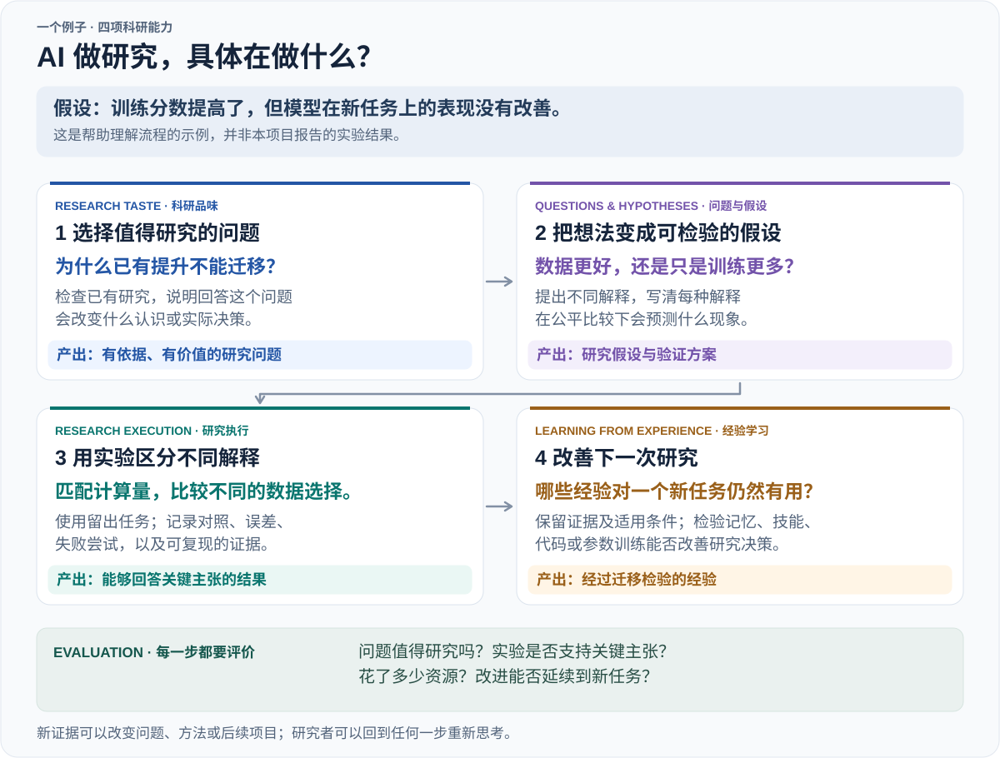
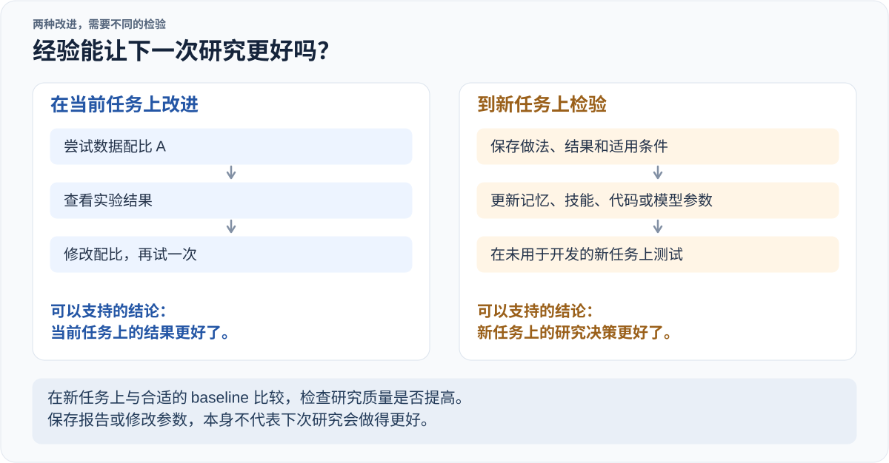

<!-- Generated by scripts/build.mjs from this template and data/*.json. -->
# Awesome Autoresearch

**学习提出更好的问题，设计更好的实验，并从研究经验中进步。**

[English](README.md) | [简体中文](README.zh-CN.md)

[](#collection) [](LICENSE) [](https://github.com/AutoResearching/Awesome-Autoresearch/actions/workflows/validate.yml)

收集关于 **AI 如何做研究的论文、代码、benchmarks 和研究者文章**：选择重要的问题，提出想法，用实验检验，再从结果中学习。

**82 项资源 · 75 篇论文记录 · 6 篇文章与演讲 · 62 个官方代码链接**

[研究地图](#research-map) · [浏览资源](#collection) · [研究机会](#research-opportunities) · [阅读路线](#reading-paths) · [推荐资源](https://github.com/AutoResearching/Awesome-Autoresearch/issues/new?template=suggest-resource.yml)

**Survey：** [英文 PDF](output/pdf/autoresearch-survey-en.pdf) · [中文 PDF](output/pdf/autoresearch-survey-zh.pdf)。涵盖截至 2026 年 10 月 26 日收录的 79 项工作。

来源核查日期：2026-10-24–2026-10-30。条目按研究主题分组，不做排名。

## 研究范围

我们关注**怎样做出更好的研究**。主要在 AI research 中做实验，也把数学作为 testbed。其他领域的工作，只要其方法有助于回答下面的问题，也会收录。

我们关心 **research quality**：问题重要吗？贡献是新的吗？证据支持结论吗？结果在什么条件下成立？负结果如果能排除一种解释，或指导下一项研究，同样有价值。

这里的 *autoresearch* 包括 AI 科研助手、单项科研能力，以及能够开展完整研究的系统。Karpathy 的 autoresearch 是其中一个例子。

<a id="research-map"></a>

## 研究地图 · Research map

模型的训练分数提高了，但新任务上的表现没有改善。AI 研究者接下来应该做什么？



这个例子用来说明四项能力，并非已完成的实验。**Question 说明想知道什么，hypothesis 给出一种可能的解释，method 说明如何研究或解决问题。** 评价时要看问题是否重要、贡献是否新颖，以及证据是否支持结果。AI scientist systems 将这些能力组合起来。

<a id="collection"></a>

### 按研究能力浏览

| 浏览目录 | 条目数 |
| --- | ---: |
| [科研品味与问题选择 · Research Taste](#taste) | 8 |
| [问题提出与假设生成 · Question Formulation](#questions) | 16 |
| [科学推理与研究执行 · Research Execution](#execution) | 11 |
| [从研究经验中学习 · Learning from Experience](#learning) | 18 |
| [基准与评价 · Benchmarks and Evaluation](#evaluation) | 17 |
| [完整科研系统 · AI Scientist Systems](#systems) | 6 |
| [科研品味与科学实践 · Essays and Perspectives](#perspectives) | 6 |

[研究机会](#research-opportunities) · [学习机制](#learning-mechanisms) · [实验场景](#choosing-a-testbed) · [阅读路线](#reading-paths)

## 科研品味与问题选择 · Research Taste

<a id="taste"></a>

什么问题值得研究？AI 能否学会选择？

| 工作 | 贡献 / 观点 | 来源 |
| --- | --- | --- |
| <a id="work-ai-can-learn-scientific-taste"></a>**Scientific Taste / RLCF**<br><sub>2026 · arXiv</sub> | 从领域与时间匹配的引用偏好中训练 Scientific Judge，再用其奖励训练 Scientific Thinker 生成后续研究想法。 | [Paper](https://arxiv.org/abs/2603.14473) · [Code](https://github.com/tongjingqi/AI-Can-Learn-Scientific-Taste) · [Project](https://tongjingqi.github.io/AI-Can-Learn-Scientific-Taste/) |
| <a id="work-hindsight"></a>**HindSight**<br><sub>2026 · arXiv</sub> | 提出回顾式评价：将生成想法与后续论文匹配，并用引用量和发表 venue 对匹配结果加权。 | [Paper](https://arxiv.org/abs/2603.15164) |
| <a id="work-innoeval"></a>**InnoEval**<br><sub>2026 · ICML 2026</sub> | 检索证据，从多个评审视角判断想法的新颖性、可行性和重要性，并给出判断理由。 | [Paper](https://arxiv.org/abs/2602.14367) · [Code](https://github.com/zjunlp/InnoEval) |
| <a id="work-rinobench"></a>**RINoBench**<br><sub>2026 · LREC 2026</sub> | 用专家判断核对新颖性评分及其解释，将研究想法评价作为独立能力来测试。 | [Paper](https://aclanthology.org/2026.lrec-1.370/) · [Code](https://github.com/TimSchopf/RINoBench) |
| <a id="work-opennovelty"></a>**OpenNovelty**<br><sub>2026 · arXiv</sub> | 提取论文的贡献主张，检索已有工作并比较全文，生成证据可追溯的新颖性报告。 | [Paper](https://arxiv.org/abs/2601.01576) · [Code](https://github.com/january-blue/OpenNovelty) · [Project](https://opennovelty.org/) |
| <a id="work-scistylebench"></a>**SciStyleBench**<br><sub>2026 · arXiv</sub> | 通过受控改变想法的表达风格与实质内容，检验 LLM judge 奖励的是科学内容还是有说服力的写作风格。 | [Paper](https://arxiv.org/abs/2608.01666) |
| <a id="work-tasteval"></a>**TasteVal**<br><sub>2026 · arXiv</sub> | 在 AI R&amp;D 任务上评估迭代实验设计与结果解释，并通过固定 coding agent 将研究决策与代码实现区分开。 | [Paper](https://arxiv.org/abs/2610.06824) · [Project](https://pzeroresearch.com/work/tasteval/) |
| <a id="work-ideation-execution-gap"></a>**Ideation-Execution Gap**<br><sub>2025 · ICLR 2026</sub> | 让研究者执行人类与 LLM 提出的想法，对比执行前后的专家评价，将提案质量与实际研究结果联系起来。 | [Paper](https://arxiv.org/abs/2506.20803) · [Code](https://github.com/NoviScl/AI-Researcher) |

<details>
<summary>完整标题与评价限制 (8)</summary>

- **Scientific Taste / RLCF** — *AI Can Learn Scientific Taste*. 方法 · 预印本 / 报告. 引用量是学术共同体反响的代理，不能直接等同于科学价值；生成想法主要由 LLM 评审，尚未经过实验验证。
- **HindSight** — *HindSight: Evaluating LLM-Generated Research Ideas via Future Impact*. 基准 · 预印本 / 报告. 论文匹配只是影响力代理，可能低估尚未被探索的想法；文中模型知识截止时间晚于检索截止时间，因此不能排除时间泄漏。
- **InnoEval** — *InnoEval: On Research Idea Evaluation as a Knowledge-Grounded, Multi-Perspective Reasoning Problem*. 方法 · 已发表. 与人类评审的一致性用于检验评审器，不能证明实验成功、长期科学价值或自主选题能力。
- **RINoBench** — *Is This Idea Novel? An Automated Benchmark for Judgment of Research Ideas*. 基准 · 已发表. 与新颖性判断一致，不等于能提出新问题、预测可行性或证明科学重要性；理由听起来合理也不代表判断正确。
- **OpenNovelty** — *OpenNovelty: An LLM-powered Agentic System for Verifiable Scholarly Novelty Assessment*. 系统 · 预印本 / 报告. 评估的是给定论文的新颖性，不负责生成问题或估计科学重要性；结论仍受检索覆盖范围与模型判断限制。
- **SciStyleBench** — *Style Wins, Substance Loses: A Diagnosis of LLM-as-Judge in Idea Generation*. 基准 · 预印本 / 报告. 测量构造扰动下评审器的稳健性与排序偏差，不直接验证被评想法的长期科学价值。
- **TasteVal** — *TasteVal: Measuring the Experimental Research Taste of AI Systems Against Human Experts*. 基准 · 预印本 / 报告. 评价的是给定问题上的实验算力效率，不衡量开放式选题；任务尚未公开。
- **Ideation-Execution Gap** — *The Ideation-Execution Gap: Execution Outcomes of LLM-Generated versus Human Research Ideas*. 实证研究 · 已发表. 执行由人类主导，结果在 NLP 研究场景中评估；它提供想法评价的证据，并非自主科研执行能力的展示。

</details>

## 问题提出与假设生成 · Question Formulation

<a id="questions"></a>

AI 如何发现重要问题，并提出可以检验的想法？

| 工作 | 贡献 / 观点 | 来源 |
| --- | --- | --- |
| <a id="work-agentideabench"></a>**AgentIdeaBench**<br><sub>2026 · arXiv</sub> | 比较给定参考文献与智能体自主检索两种假设生成方式，统一子领域、输出格式和评审器，并在评分前检索已有工作。 | [Paper](https://arxiv.org/abs/2609.07611) · [Code](https://github.com/HKUST-KnowComp/AgentIdeaBench) |
| <a id="work-rq-bench"></a>**RQ-Bench**<br><sub>2026 · arXiv</sub> | 根据论文及其引用背景构建参照研究问题，用 LLM 独立评分、成对比较与专家盲评来评价生成的问题。 | [Paper](https://arxiv.org/abs/2606.12071) · [Project](https://huggingface.co/datasets/declare-lab/rq-bench) |
| <a id="work-llm-novel-research-ideas-human-study"></a>**Human Study of Research Ideation**<br><sub>2024 · ICLR 2025</sub> | 通过专家盲审比较 LLM 与专家提出的研究方案，并分析生成多样性和自我评价的失败模式。 | [Paper](https://arxiv.org/abs/2409.04109) · [Code](https://github.com/NoviScl/AI-Researcher) |
| <a id="work-chain-of-ideas"></a>**Chain of Ideas / Idea Arena**<br><sub>2024 · Findings of EMNLP 2025</sub> | 将文献组织成研究发展链，以生成想法和实验设计，并提出 Idea Arena 对提案进行比较评价。 | [Paper](https://aclanthology.org/2025.findings-emnlp.477/) · [Code](https://github.com/DAMO-NLP-SG/CoI-Agent) |
| <a id="work-liveideabench"></a>**LiveIdeaBench**<br><sub>2024 · Nature Communications 2026</sub> | 让模型根据简短关键词提出科学想法，由动态 LLM 评审团评价原创性、可行性、流畅性、灵活性和清晰度。 | [Paper](https://www.nature.com/articles/s41467-026-70245-1) · [Code](https://github.com/x66ccff/liveideabench) · [Project](https://liveideabench.com/) |
| <a id="work-hypogenic"></a>**HypoGeniC**<br><sub>2024 · NLP4Science 2024</sub> | 从带标签样本生成假设，再利用预测错误和受 bandit 启发的选择机制，扩展与修正假设库。 | [Paper](https://aclanthology.org/2024.nlp4science-1.10/) · [Code](https://github.com/ChicagoHAI/hypothesis-generation) |
| <a id="work-ideabench"></a>**IdeaBench**<br><sub>2024 · arXiv</sub> | 以已发表论文的参考文献背景构造想法生成任务，并用 GPT-4o 的比较排序评价新颖性、可行性等指定维度。 | [Paper](https://arxiv.org/abs/2411.02429) · [Code](https://github.com/amir-hassan25/IdeaBench) |
| <a id="work-ideasynth"></a>**IdeaSynth**<br><sub>2024 · CHI 2025</sub> | 让用户结合文献反馈，修改和组合研究想法中的问题、方案、评价与贡献。 | [Paper](https://arxiv.org/abs/2410.04025) |
| <a id="work-hyporefine"></a>**HypoRefine / Literature Meets Data**<br><sub>2024 · ACL 2025</sub> | 结合文献知识与从数据生成、修正的假设，测试预测效果及其对人类决策的帮助。 | [Paper](https://aclanthology.org/2025.acl-long.12/) · [Code](https://github.com/ChicagoHAI/hypothesis-generation) |
| <a id="work-researchagent"></a>**ResearchAgent**<br><sub>2024 · NAACL 2025</sub> | 从种子论文、学术关系图与实体知识库出发，生成问题、方法和实验计划，再根据评审智能体的反馈修订。 | [Paper](https://aclanthology.org/2025.naacl-long.342/) · [Code](https://github.com/JinheonBaek/ResearchAgent) |
| <a id="work-sciagents"></a>**SciAgents**<br><sub>2024 · Advanced Materials 2025</sub> | 用知识图谱和专家智能体连接不同领域的概念，再生成、批评和完善跨学科假设。 | [Paper](https://doi.org/10.1002/adma.202413523) · [Code](https://github.com/lamm-mit/SciAgentsDiscovery) |
| <a id="work-scideator"></a>**Scideator**<br><sub>2024 · ACM CAIS 2026</sub> | 帮助研究者重组论文的目的、机制和评价方法来构思想法，并依据文献检查新颖性。 | [Paper](https://arxiv.org/abs/2409.14634) |
| <a id="work-scipip"></a>**SciPIP**<br><sub>2024 · arXiv</sub> | 通过语义、关键词和引用关系检索论文，结合自由构思与检索生成，为给定背景提出想法。 | [Paper](https://arxiv.org/abs/2410.23166) · [Code](https://github.com/cheerss/SciPIP) |
| <a id="work-coquest"></a>**CoQuest**<br><sub>2023 · CHI 2024</sub> | 研究广度优先和深度优先的问题生成，如何影响研究者与 LLM 合作时的探索、反思和控制感。 | [Paper](https://arxiv.org/abs/2310.06155) · [Code](https://github.com/yiren-liu/coquest) |
| <a id="work-moose"></a>**MOOSE**<br><sub>2023 · Findings of ACL 2024</sub> | 从网页文本提取研究背景与启发，通过多种反馈生成和完善社会科学假设。 | [Paper](https://aclanthology.org/2024.findings-acl.804/) · [Code](https://github.com/ZonglinY/MOOSE) |
| <a id="work-scimon"></a>**SciMON**<br><sub>2023 · ACL 2024</sub> | 为给定研究背景检索启发，再反复对照已有工作修改研究想法。 | [Paper](https://aclanthology.org/2024.acl-long.18/) · [Code](https://github.com/EagleW/Scientific-Inspiration-Machines-Optimized-for-Novelty) |

<details>
<summary>完整标题与评价限制 (16)</summary>

- **AgentIdeaBench** — *AgentIdeaBench: Benchmarking Scientific Ideation in the Agent Era*. 基准 · 预印本 / 报告. 主动探索同时改变顺序推理和信息获取方式。分数仍是模型判断，专家验证有限；生成的假设并非经过实验验证的发现。
- **RQ-Bench** — *On the Limits of LLM-as-Judge for Scientific Novelty Assessment*. 基准 · 预印本 / 报告. 作者问题是参照而非唯一有效答案；专家与模型对新颖性的判断存在分歧。这些分数不能确立方案可行性、执行结果或科学重要性。
- **Human Study of Research Ideation** — *Can LLMs Generate Novel Research Ideas? A Large-Scale Human Study with 100+ NLP Researchers*. 实证研究 · 已发表. 主要证据是执行前对 NLP 提案新颖性与可行性的评价；专家偏好不能证明已经实现科学发现或下游科学价值。
- **Chain of Ideas / Idea Arena** — *Chain of Ideas: Revolutionizing Research Via Novel Idea Development with LLM Agents*. 方法 · 已发表. 提案比较评分衡量的是被评判的想法质量，不能证明已经执行的科学发现；组织既有文献本身也不等于从新实验中学习。
- **LiveIdeaBench** — *Evaluating LLMs' divergent thinking capabilities for scientific idea generation with minimal context*. 基准 · 已发表. 头脑风暴与评审分数不能确认哪些问题值得投入或能带来发现；评审团变化也会增加跨时间比较的难度。
- **HypoGeniC** — *Hypothesis Generation with Large Language Models*. 方法 · 已发表. 留出集预测准确率检验假设能否捕捉有用的数据规律，不能证明因果解释或问题更广泛的科学重要性。
- **IdeaBench** — *IdeaBench: Benchmarking Large Language Models for Research Idea Generation*. 基准 · 预印本 / 报告. 相对分数衡量参考集合中被评审认可的提案质量，不能证明实验成功、因果有效性或已实现的科学价值。
- **IdeaSynth** — *IdeaSynth: Iterative Research Idea Development Through Evolving and Composing Idea Facets with Literature-Grounded Feedback*. 系统 · 已发表. 用户研究衡量的是探索与完善提案的支持效果，未证明自主选题能力或经过科学验证的研究成果。
- **HypoRefine / Literature Meets Data** — *Literature Meets Data: A Synergistic Approach to Hypothesis Generation*. 方法 · 已发表. 证据来自欺骗检测、AI 内容检测等分类与决策辅助任务；预测效用不等于因果验证或开放式科学发现。
- **ResearchAgent** — *ResearchAgent: Iterative Research Idea Generation over Scientific Literature with Large Language Models*. 方法 · 已发表. 证据来自对生成提案的人类与模型评价；生成实验设计不等于已执行并验证该实验。
- **SciAgents** — *SciAgents: Automating Scientific Discovery Through Bioinspired Multi-Agent Intelligent Graph Reasoning*. 系统 · 已发表. 展示主要聚焦仿生材料构思；提出的机制与预测性质是后续研究起点，不是经实验确认的发现，也未证明能迁移至 AI 研究。
- **Scideator** — *Scideator: Human-LLM Compound System for Scientific Ideation through Facet Recombination and Novelty Evaluation*. 系统 · 已发表. 用户研究和新颖性检查器消融评价了这一人机协作工具，未证明自主发现或实际科学影响。
- **SciPIP** — *SciPIP: An LLM-based Scientific Paper Idea Proposer*. 方法 · 预印本 / 报告. 评价采用专家对 NLP 和计算机视觉提案的评分；被认为可行或有帮助，不代表提案已经成功执行。
- **CoQuest** — *CoQuest: Exploring Research Question Co-Creation with an LLM-based Agent*. 系统 · 已发表. 证据聚焦 HCI 研究者的构思体验与感知创造力，未建立问题的最终科学重要性或自主科研成功率。
- **MOOSE** — *Large Language Models for Automated Open-domain Scientific Hypotheses Discovery*. 方法 · 已发表. 评价依赖专家与 GPT 对假设的判断；新颖性或合理性评价不能替代确认假设真实性的实验。
- **SciMON** — *SciMON: Scientific Inspiration Machines Optimized for Novelty*. 方法 · 已发表. 以新颖性为目标的提案生成依赖给定背景；相对检索文献的新颖性不能证明实验有效性或研究重要性。

</details>

## 科学推理与研究执行 · Research Execution

<a id="execution"></a>

AI 如何设计实验、检验解释，并得到可靠结论？

| 工作 | 贡献 / 观点 | 来源 |
| --- | --- | --- |
| <a id="work-autoresearch"></a>**Karpathy's autoresearch**<br><sub>2026 · Open-source project</sub> | 面向单 GPU 语言模型训练的修改—训练—评价—保留循环，可作为简洁的科研执行 baseline。 | [Code](https://github.com/karpathy/autoresearch) |
| <a id="work-arbor"></a>**Arbor**<br><sub>2026 · arXiv</sub> | 用持久化假设树保存假设、实验产物、证据与可复用经验，由 coordinator 和隔离的 executors 管理。 | [Paper](https://arxiv.org/abs/2606.11926) · [Code](https://github.com/RUC-NLPIR/Arbor) · [Project](https://RUC-NLPIR.github.io/Arbor/) |
| <a id="work-aletheia"></a>**Aletheia**<br><sub>2026 · arXiv</sub> | 在研究级数学问题上迭代生成、验证、修订与文献使用，并讨论自主程度、新颖性和人类贡献的记录。 | [Paper](https://arxiv.org/abs/2602.10177) · [Resources](https://github.com/google-deepmind/superhuman/tree/main/aletheia) |
| <a id="work-aide"></a>**AIDE**<br><sub>2025 · arXiv</sub> | 将 ML 实验建模为可执行代码空间中的 tree search，用实际测量结果决定生成、调试或改进哪个候选方案。 | [Paper](https://arxiv.org/abs/2502.13138) · [Code](https://github.com/WecoAI/aideml) |
| <a id="work-alphaevolve"></a>**AlphaEvolve**<br><sub>2025 · arXiv / technical report</sub> | 利用 LLM 候选方案与自动 evaluator 的反馈，演化数学和计算任务中的算法实现。 | [Paper](https://arxiv.org/abs/2506.13131) · [Project](https://deepmind.google/blog/alphaevolve-a-gemini-powered-coding-agent-for-designing-advanced-algorithms/) |
| <a id="work-popper"></a>**POPPER**<br><sub>2025 · ICML 2025</sub> | 让智能体设计并执行检验，测试给定自然语言假设的可测量推论，再用 e-values 逐步汇总证据。 | [Paper](https://proceedings.mlr.press/v267/huang25n.html) · [Code](https://github.com/snap-stanford/POPPER) |
| <a id="work-curie"></a>**Curie**<br><sub>2025 · arXiv</sub> | 协调规划与执行智能体，复现、扩展或质疑计算实验结论；检查环境、控制任务交接，并保存结构化实验记录。 | [Paper](https://arxiv.org/abs/2502.16069) · [Code](https://github.com/Just-Curieous/Curie) · [Project](https://www.just-curieous.com/) |
| <a id="work-rd-agent"></a>**R&amp;D-Agent**<br><sub>2025 · arXiv</sub> | 将改进想法的提出与评价，同实现和调试分开，便于扩展迭代研发流程。 | [Paper](https://arxiv.org/abs/2505.14738) · [Code](https://github.com/microsoft/RD-Agent) · [Project](https://rdagent.readthedocs.io/en/latest/index.html) |
| <a id="work-autora"></a>**AutoRA**<br><sub>2024 · Journal of Open Source Software 2024</sub> | 通过可替换的实验设计、实验执行和理论建模模块，连接实验设计、数据收集与科学模型发现。 | [Paper](https://joss.theoj.org/papers/10.21105/joss.06839) · [Code](https://github.com/AutoResearch/autora) · [Project](https://autoresearch.github.io/autora/) |
| <a id="work-funsearch"></a>**FunSearch**<br><sub>2023 · Nature 2023</sub> | 结合 LLM 程序生成、可执行评价与演化搜索，寻找数学构造和算法。 | [Paper](https://www.nature.com/articles/s41586-023-06924-6) · [Code](https://github.com/google-deepmind/funsearch) |
| <a id="work-deep-adaptive-design"></a>**Deep Adaptive Design (DAD)**<br><sub>2021 · ICML 2021</sub> | 学习可复用的 experimental-design policy，根据已有观测选择下一次实验，并优化整个实验序列的信息增益。 | [Paper](https://proceedings.mlr.press/v139/foster21a.html) · [Code](https://github.com/ae-foster/dad) |

<details>
<summary>完整标题与评价限制 (11)</summary>

- **Karpathy's autoresearch** — *autoresearch*. 系统 · 项目. 在短时训练中优化固定指标，研究指令由人类编写；指标提升不能验证问题选择或 taste 学习。
- **Arbor** — *Toward Generalist Autonomous Research via Hypothesis-Tree Refinement*. 系统 · 预印本 / 报告. 主要评价给定产物与目标下的自主优化；证据积累本身不能等同于广泛的科学问题选择。
- **Aletheia** — *Towards Autonomous Mathematics Research*. 系统 · 预印本 / 报告. 采用自然语言推理，并非所有结果都经过形式化证明检查；链接公开的是 prompts 与输出，不是完整 agent 实现。
- **AIDE** — *AIDE: AI-Driven Exploration in the Space of Code*. 方法 · 预印本 / 报告. 目标、数据与优化指标由外部给定，因此 Kaggle、MLE-bench 和 RE-Bench 表现衡量的是执行与搜索能力，而非研究问题的重要性。
- **AlphaEvolve** — *AlphaEvolve: A coding agent for scientific and algorithmic discovery*. 系统 · 预印本 / 报告. 需要可执行的目标与评价过程；给定任务内的已验证改进，不等于自主选题价值的评价。
- **POPPER** — *Automated Hypothesis Validation with Agentic Sequential Falsifications*. 方法 · 已发表. 评估使用已有数据集，Type-I error control 依赖有效的逻辑蕴含与条件检验；它没有验证跨多个假设的 false discovery rate control。
- **Curie** — *Curie: Toward Rigorous and Automated Scientific Experimentation with AI Agents*. 方法 · 预印本 / 报告. 研究给定四个计算机科学领域的问题和背景。LLM 与人工混合评价不能提供科学有效性的形式化保证，也未证明自主选题能力。
- **R&amp;D-Agent** — *R&amp;D-Agent: An LLM-Agent Framework Towards Autonomous Data Science*. 方法 · 预印本 / 报告. 所链接报告评价 MLE-bench 上的 ML engineering。同一仓库中的金融和 fine-tuning 论文，不能为本工作证明自主科研选题能力。
- **AutoRA** — *AutoRA: Automated Research Assistant for Closed-Loop Empirical Research*. 方法 · 已发表. 用户需指定变量、实验接口与模型发现组件；该框架本身没有验证自主选择重要科学问题的能力。
- **FunSearch** — *Mathematical discoveries from program search with large language models*. 方法 · 已发表. 目标和 evaluator 由人类提供；公开研究代码不包含语言模型、沙箱和分布式基础设施。
- **Deep Adaptive Design (DAD)** — *Deep Adaptive Design: Amortizing Sequential Bayesian Experimental Design*. 方法 · 已发表. 这是依赖给定 likelihood、prior 与设计空间的 Bayesian design 基础方法，尚不体现自主发明研究目标或科学模型类别的能力。

</details>

## 从研究经验中学习 · Learning from Experience

<a id="learning"></a>

AI 能从一次研究中学到什么，帮助它做好下一次研究？

| 工作 | 贡献 / 观点 | 来源 |
| --- | --- | --- |
| <a id="work-agora"></a>**Agora**<br><sub>2026 · arXiv</sub> | 用 Git 保存假设、结果与核验组成的共享图，使不同会话中的科研智能体能够复用和延续集体研究。 | [Paper](https://arxiv.org/abs/2609.18094) · [Project](https://yifanzhang-pro.github.io/Agora/) |
| <a id="work-autoresearchclaw"></a>**AutoResearchClaw**<br><sub>2026 · arXiv</sub> | 保存失败研究中的经验，随时间降低其权重，并在后续研究中检索以避免重复错误；人类参与程度可配置。 | [Paper](https://arxiv.org/abs/2605.20025) · [Code](https://github.com/aiming-lab/AutoResearchClaw) |
| <a id="work-bilevel-autoresearch"></a>**Bilevel Autoresearch**<br><sub>2026 · arXiv</sub> | 外层循环读取搜索记录并改写 Python 搜索策略，改变内层 autoresearch 循环提出和评价训练配置的方式。 | [Paper](https://arxiv.org/abs/2603.23420) · [Code](https://github.com/EdwardOptimization/Bilevel-Autoresearch) |
| <a id="work-evolution-fine-tuning"></a>**Evolution Fine-Tuning / Finch**<br><sub>2026 · NeurIPS 2026 (accepted)</sub> | 用多个优化领域的进化搜索轨迹监督训练 Finch 模型，测试对留出任务的迁移，以及与测试时 RL 的结合。 | [Paper](https://arxiv.org/abs/2606.29082) · [Code](https://github.com/Open-Galapagos/evolution-fine-tuning) · [Project](https://open-galapagos.github.io/evolution_finetuning/) |
| <a id="work-evoscientist"></a>**EvoScientist**<br><sub>2026 · arXiv</sub> | 演化管理智能体将已完成的研究轨迹转为持久的构思与实验记忆，供研究和工程智能体在后续任务中检索。 | [Paper](https://arxiv.org/abs/2603.08127) · [Code](https://github.com/EvoScientist/EvoScientist) |
| <a id="work-hypoforge"></a>**HypoForge**<br><sub>2026 · arXiv</sub> | 用比较式批评和执行反馈改进可复用的假设生成与检验技能，再在留出任务上测试；无需微调基础模型。 | [Paper](https://arxiv.org/abs/2608.25770) |
| <a id="work-internagent-1-5"></a>**InternAgent-1.5**<br><sub>2026 · arXiv</sub> | 通过策略记忆、单次运行内的实验记录和跨会话知识复用研究经验，在长周期研究中连接生成、验证与演化。 | [Paper](https://arxiv.org/abs/2602.08990) · [Code](https://github.com/InternScience/InternAgent) |
| <a id="work-researchtrails"></a>**ResearchTrails**<br><sub>2026 · arXiv</sub> | 从 Git 历史提取研究者的决策，比较推理时使用示例与提炼技能，以及用 SFT、RL 学习选择下一步研究行动。 | [Paper](https://arxiv.org/abs/2610.07184) · [Code](https://github.com/xuchengong/ResearchTrails) · [Project](https://researchtrails.org/blog/) |
| <a id="work-ttt-discover"></a>**TTT-Discover**<br><sub>2026 · ICML 2026</sub> | 在搜索单个问题的解时，用 RL 更新模型参数，并在数学、算子、算法和生物数据分析中使用连续奖励。 | [Paper](https://proceedings.mlr.press/v306/yuksekgonul26a.html) · [Code](https://github.com/test-time-training/discover) · [Project](https://test-time-training.github.io/discover/) |
| <a id="work-mle-ideator"></a>**MLE-Ideator**<br><sub>2026 · EACL 2026 (Short Papers)</sub> | 将构思与实现分开，用执行结果提供的 RL 奖励训练构思模型，再在留出的 ML 工程任务上测试其指导作用。 | [Paper](https://aclanthology.org/2026.eacl-short.32/) |
| <a id="work-or-agent"></a>**OR-Agent**<br><sub>2026 · arXiv</sub> | 通过树搜索与回溯改进启发式算法，用反思、结果总结和累积经验指导同一优化过程中的后续分支。 | [Paper](https://arxiv.org/abs/2602.13769) · [Code](https://github.com/qiliuchn/OR-Agent) |
| <a id="work-scisense"></a>**SciSense**<br><sub>2026 · arXiv</sub> | 依据引用文献构建结构化构思轨迹，用于监督训练研究规划模型，并比较重建已知贡献与生成新研究想法。 | [Paper](https://arxiv.org/abs/2605.00557) · [Code](https://github.com/minnesotanlp/SciSense) |
| <a id="work-agentrxiv"></a>**AgentRxiv**<br><sub>2025 · arXiv</sub> | 科研智能体通过共享报告库检索和发布研究结果，在多轮研究中复用先前的推理与提示方法实验。 | [Paper](https://arxiv.org/abs/2503.18102) · [Code](https://github.com/SamuelSchmidgall/AgentLaboratory) · [Project](https://agentrxiv.github.io/) |
| <a id="work-dolphin"></a>**Dolphin**<br><sub>2025 · ACL 2025</sub> | 连接构思生成、代码实现与实验分析，把上一轮结果反馈给下一轮研究。 | [Paper](https://aclanthology.org/2025.acl-long.1056/) · [Code](https://github.com/InternScience/Dolphin) · [Project](https://alpha-innovator.github.io/Dolphin-project-page/) |
| <a id="work-cycleresearcher"></a>**CycleResearcher**<br><sub>2024 · ICLR 2025</sub> | 以研究生成策略模型和自动审稿模型进行迭代偏好训练，改进研究规划与论文文本生成。 | [Paper](https://arxiv.org/abs/2411.00816) · [Code](https://github.com/zhu-minjun/Researcher) |

<details>
<summary>完整标题与评价限制 (15)</summary>

- **Agora** — *Agora: Git as Shared Memory for Collective AutoResearch*. 系统 · 预印本 / 报告. 权重迁移案例展示了复用与核验；论文指出仍需匹配对照才能确定单位算力的发现收益。共享状态不等于模型训练。
- **AutoResearchClaw** — *AutoResearchClaw: Self-Reinforcing Autonomous Research with Human-AI Collaboration*. 系统 · 预印本 / 报告. 它复用外部经验，不训练模型。消融实验主要显示已知错误减少，未证明科学质量上限提高或学会判断研究的重要性。
- **Bilevel Autoresearch** — *Bilevel Autoresearch: Meta-Autoresearching Itself*. 方法 · 预印本 / 报告. 证据来自单个 GPT 预训练任务的少量重复实验。改动的是搜索代码而非模型参数；未证明跨任务迁移或无限递归改进。
- **Evolution Fine-Tuning / Finch** — *Evolution Fine-Tuning: Learning to Discover Across 371 Optimization Tasks*. 方法 · 预印本 / 报告. 训练在给定目标和评价器的任务间迁移，不代表学会判断问题重要性。数据收集和主要评价使用同一搜索框架，尚未证明跨科研工作流的广泛迁移。
- **EvoScientist** — *EvoScientist: Towards Multi-Agent Evolving AI Scientists for End-to-End Scientific Discovery*. 系统 · 预印本 / 报告. 适应依靠复用已保存的策略，不是训练基础模型。构思评分与执行结果不能证明对科学重要性的通用判断力。
- **HypoForge** — *HypoForge: A Self-Improving Multi-Agent Framework for Automated Hypothesis Generation and Testing via Scientific Skill Learning*. 方法 · 预印本 / 报告. 检验通过指标要求参考假设的执行成功且 p &lt; 0.05；这本身不能确立假阳性控制或科学重要性，适应过程也不更新基础模型参数。
- **InternAgent-1.5** — *InternAgent-1.5: A Unified Agentic Framework for Long-Horizon Autonomous Scientific Discovery*. 系统 · 预印本 / 报告. 记忆同时支持单次运行内适应和跨运行复用。现有结果未单独验证跨领域策略迁移，也未证明基础模型通过参数更新学会科研品味。
- **ResearchTrails** — *Learning Scientific Exploration from Human Research Decision Trajectories*. 方法 · 预印本 / 报告. Git 提交只能记录部分研究经验。评价主要检查决策与历史记录的相似度，未验证所学策略能否产生重要的新发现。
- **TTT-Discover** — *Learning to Discover at Test Time*. 方法 · 已发表. 目标和评价器由环境给定。单任务测试时训练不能证明能力提升会保留到新任务，也未验证重要研究问题的选择能力。
- **MLE-Ideator** — *Learning to Ideate for Machine Learning Engineering Agents*. 方法 · 已发表. 任务目标由 MLE-Bench 给定。结果检验工程指导能力的迁移，不检验有价值问题的选择。报告中的评价未覆盖高复杂度任务。
- **OR-Agent** — *OR-Agent: Bridging Evolutionary Search and Structured Research for Automated Heuristic Design*. 方法 · 预印本 / 报告. 测试针对给定的组合优化与仿真优化任务。“语言梯度”和“动量”描述反思机制，不是参数更新；未验证科研策略的跨任务迁移。
- **SciSense** — *Structure Liberates: How Constrained Sensemaking Produces More Novel Research Output*. 方法 · 预印本 / 报告. 轨迹由模型合成，并非人类思考的真实记录。新颖性评分和小规模计算机科学执行实验不能确立通用科学价值。公开代码覆盖 SFT 与评价，不含探索性 RL 实验。
- **AgentRxiv** — *AgentRxiv: Towards Collaborative Autonomous Research*. 系统 · 预印本 / 报告. 证据针对给定基准目标上的累积进展；复用报告不等于已经学会科研品味或通用跨领域科研策略。
- **Dolphin** — *Dolphin: Moving Towards Closed-loop Auto-research through Thinking, Practice, and Feedback*. 系统 · 已发表. 反馈用于改进给定主题内的搜索；本身不能证明跨任务科研策略学习、模型参数更新或科研品味学习。
- **CycleResearcher** — *CycleResearcher: Improving Automated Research via Automated Review*. 方法 · 已发表. 主要结果评价生成稿件和审稿分数；其中实验结果由模型生成，实验并未实际运行。附录接入了外部执行器，但执行不属于核心方法。

</details>

### 相关基础方法

这些方法可能有助于构建科研 agent，但原始实验没有直接评价科学发现或 research taste。

| 工作 | 贡献 / 观点 | 来源 |
| --- | --- | --- |
| <a id="work-darwin-godel-machine"></a>**Darwin Gödel Machine**<br><sub>2025 · ICLR 2026</sub> | 维护不断演化的编程智能体档案，让智能体修改自身代码，并通过编程基准评估产生的新版本。 | [Paper](https://arxiv.org/abs/2505.22954) · [Code](https://github.com/jennyzzt/dgm) |
| <a id="work-adas"></a>**ADAS**<br><sub>2024 · ICLR 2025</sub> | 元智能体利用既有设计与评估档案搜索智能体程序，并开展跨任务和基础模型的迁移测试。 | [Paper](https://arxiv.org/abs/2408.08435) · [Code](https://github.com/ShengranHu/ADAS) · [Project](https://www.shengranhu.com/ADAS/) |
| <a id="work-reflexion"></a>**Reflexion**<br><sub>2023 · NeurIPS 2023</sub> | 将任务反馈转化为语言反思并存入情景记忆，以指导后续尝试，无需更新模型参数。 | [Paper](https://arxiv.org/abs/2303.11366) · [Code](https://github.com/noahshinn/reflexion) |

<details>
<summary>完整标题与评价限制 (3)</summary>

- **Darwin Gödel Machine** — *Darwin Gödel Machine: Open-Ended Evolution of Self-Improving Agents*. 基础方法 · 已发表. 在编程任务中展示智能体自我改进。基准提升不构成自我修改有益性的形式化保证，也不是科研品味的证据。
- **ADAS** — *Automated Design of Agentic Systems*. 基础方法 · 已发表. 属于针对给定任务目标改进智能体工作流的基础方法；基准迁移不能证明其能选择重要的科学问题。
- **Reflexion** — *Reflexion: Language Agents with Verbal Reinforcement Learning*. 基础方法 · 已发表. 评价覆盖决策、编程与推理任务，支持推理时适应；这些结果不能直接证明科学发现或科研品味学习。

</details>

## 基准与评价 · Benchmarks and Evaluation

<a id="evaluation"></a>

问题重要吗？贡献是新的吗？证据支持吗？结果在什么条件下成立？

| 工作 | 贡献 / 观点 | 来源 |
| --- | --- | --- |
| <a id="work-airs-bench"></a>**AIRS-Bench**<br><sub>2026 · arXiv</sub> | 要求智能体在没有基线代码的情况下解决来自 ML 论文的任务，测试跨领域的构思、实验分析和迭代改进。 | [Paper](https://arxiv.org/abs/2602.06855) · [Code](https://github.com/facebookresearch/airs-bench) |
| <a id="work-fml-bench"></a>**FML-bench**<br><sub>2026 · arXiv</sub> | 用统一执行工具比较科研智能体如何探索和改进方案，将搜索策略与执行基础设施分开，并记录研究过程。 | [Paper](https://arxiv.org/abs/2605.17373) · [Code](https://github.com/qrzou/FML-bench) |
| <a id="work-many-ai-analysts-one-dataset"></a>**Many AI Analysts, One Dataset**<br><sub>2026 · PNAS 2026</sub> | 比较不同模型和 persona 对同一数据集与假设的自主分析，展示分析选择如何改变结论，并主张报告不同分析路径。 | [Paper](https://www.pnas.org/doi/10.1073/pnas.2606495123) · [Code](https://github.com/amazon-science/agentic-forking-path) |
| <a id="work-posttrainbench"></a>**PostTrainBench**<br><sub>2026 · arXiv</sub> | 给定基础语言模型和目标 benchmark，让智能体在单张 H100、十小时内自主构建数据、选择方法和运行实验，以改进表现。 | [Paper](https://arxiv.org/abs/2603.08640) · [Code](https://github.com/aisa-group/PostTrainBench) · [Project](https://posttrainbench.com/) |
| <a id="work-mlgym"></a>**MLGym**<br><sub>2025 · COLM 2025</sub> | 通过 Gym 式接口提供视觉、语言、强化学习与博弈研究任务，用于评价智能体和开发科研行为学习算法。 | [Paper](https://arxiv.org/abs/2502.14499) · [Code](https://github.com/facebookresearch/MLGym) · [Project](https://sites.google.com/view/mlgym) |
| <a id="work-mlr-bench"></a>**MLR-Bench**<br><sub>2025 · NeurIPS 2025 Datasets and Benchmarks</sub> | 以 workshop 研究主题为任务，用 MLR-Judge 评价想法、方案、实验和论文，考察单一预测分数之外的研究产出。 | [Paper](https://arxiv.org/abs/2505.19955) · [Code](https://github.com/chchenhui/mlrbench) · [Project](https://chchenhui.github.io/mlrbench/) |
| <a id="work-paperbench"></a>**PaperBench**<br><sub>2025 · ICML 2025</sub> | 检验智能体能否实现 ML 论文的方法、运行实验并复现结果。原作者参与制定评分标准，自动评审器也接受单独评估。 | [Paper](https://arxiv.org/abs/2504.01848) · [Code](https://github.com/openai/frontier-evals/tree/main/project/paperbench) · [Project](https://openai.com/index/paperbench/) |
| <a id="work-core-bench"></a>**CORE-Bench**<br><sub>2024 · TMLR 2025</sub> | 通过安装依赖、执行给定科学代码并解释数值或图像输出，评估 computational reproducibility。 | [Paper](https://arxiv.org/abs/2409.11363) · [Code](https://github.com/siegelz/core-bench) · [Project](https://hal.cs.princeton.edu/corebench_hard) |
| <a id="work-discoverybench"></a>**DiscoveryBench**<br><sub>2024 · ICLR 2025</sub> | 在真实与合成数据集上测试假设搜索和验证，按发现关系的各个部分评分，评价范围超出代码能否运行。 | [Paper](https://arxiv.org/abs/2407.01725) · [Code](https://github.com/allenai/discoverybench) |
| <a id="work-discoveryworld"></a>**DiscoveryWorld**<br><sub>2024 · NeurIPS 2024 Datasets and Benchmarks</sub> | 在模拟环境中评价假设形成、干预、实验和解释的完整循环，同时衡量任务完成与获得的解释性知识。 | [Paper](https://arxiv.org/abs/2406.06769) · [Code](https://github.com/allenai/discoveryworld) · [Project](https://allenai.github.io/discoveryworld/) |
| <a id="work-frontiermath"></a>**FrontierMath**<br><sub>2024 · arXiv</sub> | 用专家编写、答案可自动检查的高难度数学问题，测试数学推理与计算探索。 | [Paper](https://arxiv.org/abs/2411.04872) · [Project](https://epoch.ai/frontiermath/tiers-1-4/the-benchmark) |
| <a id="work-mle-bench"></a>**MLE-bench**<br><sub>2024 · ICLR 2025</sub> | 用 Kaggle 任务测试数据准备、模型训练和实验迭代，并提供人类竞赛基线，分析计算预算和数据污染的影响。 | [Paper](https://arxiv.org/abs/2410.07095) · [Code](https://github.com/openai/mle-bench) · [Project](https://openai.com/index/mle-bench/) |
| <a id="work-re-bench"></a>**RE-Bench**<br><sub>2024 · ICML 2025</sub> | 提供 AI 科研工程任务和人类专家尝试记录，比较智能体表现、搜索策略，以及增加时间预算带来的收益。 | [Paper](https://arxiv.org/abs/2411.15114) · [Code](https://github.com/METR/RE-Bench) |
| <a id="work-scicode"></a>**SciCode**<br><sub>2024 · NeurIPS 2024 Datasets and Benchmarks</sub> | 用科学家整理的研究问题及可测试子问题，衡量模型结合科学知识、推理与可执行代码的能力。 | [Paper](https://arxiv.org/abs/2407.13168) · [Code](https://github.com/scicode-bench/SciCode) · [Project](https://scicode-bench.github.io/) |
| <a id="work-scienceagentbench"></a>**ScienceAgentBench**<br><sub>2024 · ICLR 2025</sub> | 用来自已发表研究、经专家核验的任务测试生成程序，根据执行结果评价可靠性，并单独记录成本。 | [Paper](https://arxiv.org/abs/2410.05080) · [Code](https://github.com/OSU-NLP-Group/ScienceAgentBench) · [Project](https://osu-nlp-group.github.io/ScienceAgentBench/) |
| <a id="work-mlagentbench"></a>**MLAgentBench**<br><sub>2023 · ICML 2024</sub> | 让智能体在可执行环境中检查文件、运行实验并改进 ML 模型，利用过程记录分析规划和实验行为。 | [Paper](https://arxiv.org/abs/2310.03302) · [Code](https://github.com/snap-stanford/MLAgentBench) |
| <a id="work-scienceworld"></a>**ScienceWorld**<br><sub>2022 · EMNLP 2022</sub> | 要求 agents 在交互式文本环境中开展实验并完成任务，用实际行动检验 scientific reasoning。 | [Paper](https://aclanthology.org/2022.emnlp-main.775/) · [Code](https://github.com/allenai/ScienceWorld) · [Project](https://sciworld.apps.allenai.org/) |

<details>
<summary>完整标题与评价限制 (17)</summary>

- **AIRS-Bench** — *AIRS-Bench: a Suite of Tasks for Frontier AI Research Science Agents*. 基准 · 预印本 / 报告. 每个任务仍给定问题、数据集与指标；超过参考分数不等于自主发现研究问题或证明科学意义。
- **FML-bench** — *FML-bench: A Controlled Study of AI Research Agent Strategies from the Perspective of Search Dynamics*. 基准 · 预印本 / 报告. 智能体在固定任务上改进给定基线代码；2026 年 main 版本与 2025 年 legacy 版本不同，不应混用任务与结论。
- **Many AI Analysts, One Dataset** — *Many AI analysts, one dataset: Navigating the agentic data science multiverse*. 实证研究 · 已发表. 研究在三个数据集上固定假设与 estimand，并用 AI auditor 检查分析。它揭示分析差异，不能保证每个保留分析都正确，也未验证自主选题能力。
- **PostTrainBench** — *PostTrainBench: Can LLM Agents Automate LLM Post-Training?*. 基准 · 预印本 / 报告. 基础模型和目标 benchmark 由环境给定，衡量的是受限预算下的后训练，而非选题能力。排行榜版本会调整评分与完整性规则；官方 instruct-model 基线未匹配训练计算预算。
- **MLGym** — *MLGym: A New Framework and Benchmark for Advancing AI Research Agents*. 基准 · 已发表. 探索发生在给定任务内；benchmark 分数提高本身不足以证明算法创新或科学判断力的学习。
- **MLR-Bench** — *MLR-Bench: Evaluating AI Agents on Open-Ended Machine Learning Research*. 基准 · 已发表. 研究主题由环境给定。LLM 评审分数只是研究质量的代理，实验、新颖性和价值仍需独立核验。
- **PaperBench** — *PaperBench: Evaluating AI's Ability to Replicate AI Research*. 基准 · 已发表. 待复现论文由环境给定。Code-Dev 评价代码实现，完整复现还要求执行和结果；二者都不评价原创问题选择。
- **CORE-Bench** — *CORE-Bench: Fostering the Credibility of Published Research Through a Computational Reproducibility Agent Benchmark*. 基准 · 已发表. 它复现已有研究产物，不评估新问题的选择；原始 harness 已停止维护，其推荐的 HAL 后续实现目前也已归档。
- **DiscoveryBench** — *DiscoveryBench: Towards Data-Driven Discovery with Large Language Models*. 基准 · 已发表. 数据集与发现目标由环境提供，结果与参考假设比较；不评价自主选择不受限研究议程的能力。
- **DiscoveryWorld** — *DISCOVERYWORLD: A Virtual Environment for Developing and Evaluating Automated Scientific Discovery Agents*. 基准 · 已发表. 受控模拟便于检查发现行为，但其中的成功不能直接证明向真实科学的迁移或重要问题的自主选择。
- **FrontierMath** — *FrontierMath: A Benchmark for Evaluating Advanced Mathematical Reasoning in AI*. 基准 · 预印本 / 报告. 本条指原始答案检查型 benchmark，不代表形式化证明验证或自主猜想选择；正确性本身不衡量 research taste。
- **MLE-bench** — *MLE-bench: Evaluating Machine Learning Agents on Machine Learning Engineering*. 基准 · 已发表. 衡量给定目标下的 ML engineering，不直接衡量 research taste；官方排行榜于 2026 年 4 月暂停接收新提交以改进可比性。
- **RE-Bench** — *RE-Bench: Evaluating frontier AI R&amp;D capabilities of language model agents against human experts*. 基准 · 已发表. 适合作为有限 AI R&amp;D 任务的历史参考，不直接评价 research taste；官方任务仓库目前已标记 deprecated。
- **SciCode** — *SciCode: A Research Coding Benchmark Curated by Scientists*. 基准 · 已发表. 它测试给定编程问题而非发现的科学价值；2026 年 SciCode-Verified 审计报告了题目规范与评分缺陷，因此需区分 benchmark 版本与评估设置。
- **ScienceAgentBench** — *ScienceAgentBench: Toward Rigorous Assessment of Language Agents for Data-Driven Scientific Discovery*. 基准 · 已发表. 评价指定的数据驱动任务，而非无限制的科学发现；应使用 2026 年 4 月发布的 verified split 减少已知评分假阴性。
- **MLAgentBench** — *MLAgentBench: Evaluating Language Agents on Machine Learning Experimentation*. 基准 · 已发表. 数据集与研究目标由环境给定；模型改进衡量实验能力，不直接评价自主选择重要科学问题的能力。
- **ScienceWorld** — *ScienceWorld: Is your Agent Smarter than a 5th Grader?*. 基准 · 已发表. 任务覆盖基础科学而非前沿发现，且 1.3.0 改变了模拟对象顺序并可能影响轨迹，因此比较结果需注明环境版本。2026-10-30 链接检查未能连通在线 demo；论文与代码仍可访问。

</details>

## 完整科研系统 · AI Scientist Systems

<a id="systems"></a>

系统如何组合这些能力？哪些步骤仍需要人类参与？

| 工作 | 贡献 / 观点 | 来源 |
| --- | --- | --- |
| <a id="work-co-scientist"></a>**Co-Scientist**<br><sub>2025 · Nature 2026</sub> | 围绕科学家给定的目标生成、批评、排序和演化假设，并在生物医学案例中开展后续实验验证。 | [Paper](https://www.nature.com/articles/s41586-026-10644-y) |
| <a id="work-agent-laboratory"></a>**Agent Laboratory**<br><sub>2025 · Findings of EMNLP 2025</sub> | 提供从人工研究 idea 到文献综述、实验和报告的可检查流程，并支持各阶段的人类反馈。 | [Paper](https://aclanthology.org/2025.findings-emnlp.320/) · [Code](https://github.com/SamuelSchmidgall/AgentLaboratory) · [Project](https://agentlaboratory.github.io/) |
| <a id="work-ai-researcher"></a>**AI-Researcher / Scientist-Bench**<br><sub>2025 · NeurIPS 2025</sub> | 结合文献综述、假设生成、实现与报告；Scientist-Bench 区分引导式创新与给定研究主题内的探索。 | [Paper](https://arxiv.org/abs/2505.18705) · [Code](https://github.com/HKUDS/AI-Researcher) |
| <a id="work-kosmos"></a>**Kosmos**<br><sub>2025 · arXiv</sub> | 通过结构化 world model 连接文献搜索、假设生成与数据分析，支持更长程的研究。 | [Paper](https://arxiv.org/abs/2511.02824) · [Project](https://edisonscientific.com/news/announcing-kosmos) |
| <a id="work-ai-scientist-v2"></a>**The AI Scientist-v2**<br><sub>2025 · arXiv</sub> | 通过实验管理 agent 与 agentic tree search 探索假设、运行 ML 实验，解除 v1 对人工代码模板的依赖。 | [Paper](https://arxiv.org/abs/2504.08066) · [Code](https://github.com/SakanaAI/AI-Scientist-v2) |
| <a id="work-ai-scientist"></a>**The AI Scientist**<br><sub>2024 · arXiv</sub> | 把 idea 生成、编码、实验、报告和自动评审连接为可检查的 ML 科研流程。 | [Paper](https://arxiv.org/abs/2408.06292) · [Code](https://github.com/SakanaAI/AI-Scientist) |

<details>
<summary>完整标题与评价限制 (6)</summary>

- **Co-Scientist** — *Accelerating scientific discovery with Co-Scientist*. 系统 · 已发表. 假设演化使用 test-time computation；流程仍包含人工目标与实验室验证，尚未确立跨项目的 taste 学习。
- **Agent Laboratory** — *Agent Laboratory: Using LLM Agents as Research Assistants*. 系统 · 已发表. 从人类提供的 idea 出发，主要验证科研协作与执行，不直接验证自主选择有价值问题的能力。
- **AI-Researcher / Scientist-Bench** — *AI-Researcher: Autonomous Scientific Innovation*. 系统 · 已发表. 实现成功率与论文质量评分，需要与独立复现的发现、开放式研究议题选择区分。
- **Kosmos** — *Kosmos: An AI Scientist for Autonomous Discovery*. 系统 · 预印本 / 报告. 从给定目标与数据集出发；可追溯的报告仍可能包含错误，或统计显著但科学意义有限的结果。
- **The AI Scientist-v2** — *The AI Scientist-v2: Workshop-Level Automated Scientific Discovery via Agentic Tree Search*. 系统 · 预印本 / 报告. 论文报告的是有限的 workshop 投稿案例；录用是一种评价信号，不代表已验证通用 research taste。
- **The AI Scientist** — *The AI Scientist: Towards Fully Automated Open-Ended Scientific Discovery*. 系统 · 预印本 / 报告. 原始实验依赖人工编写的代码模板；自动评审分数不能确立独立的科学价值。

</details>

**版本说明：** The AI Scientist v1 与 v2 作为不同实现报告分别保留。后续期刊整合版为 [Towards end-to-end automation of AI research](https://www.nature.com/articles/s41586-026-10265-5)，Nature 2026；这里作为后续版本链接，不额外计为独立系统。

## 科研品味与科学实践 · Essays and Perspectives

<a id="perspectives"></a>

研究者分享选题和做好研究的建议。这些文章提供思路，不是验证 AI 能力的实验。

| 工作 | 贡献 / 观点 | 来源 |
| --- | --- | --- |
| <a id="work-nielsen-research-heuristics"></a>**Quick Thoughts on Research**<br><sub>2023 · Michael Nielsen's notebook</sub> | 讨论如何发现值得研究的问题、积累难以言传的判断经验，以及通过复盘已完成研究来学习。 | [Read](https://michaelnotebook.com/qtr/index.html) |
| <a id="work-vision-of-metascience"></a>**A Vision of Metascience**<br><sub>2022 · Science++</sub> | 提出建立能够学习如何支持更好研究的机构，用 metascience 改善资源分配等科学活动中的社会过程。 | [Read](https://scienceplusplus.org/metascience/index.html) |
| <a id="work-colah-taste-exercises"></a>**Research Taste Exercises**<br><sub>2021 · Chris Olah's notes</sub> | 建议用导师快速、低成本的反馈反复练习科研判断，不必每次等待完整研究结束。 | [Read](https://colah.github.io/notes/taste/) |
| <a id="work-research-debt"></a>**Research Debt**<br><sub>2017 · Distill</sub> | 将积累的复杂性和沟通障碍称为 research debt，把清晰解释、改进抽象和知识提炼视为研究贡献，帮助他人理解与拓展研究。 | [Read](https://distill.pub/2017/research-debt/) |
| <a id="work-karpathy-phd-guide"></a>**Karpathy's PhD Guide**<br><sub>2016 · Andrej Karpathy's blog</sub> | 结合计算机科学与机器学习博士经历，讨论如何选择有前景的问题、发展想法并执行研究。 | [Read](https://karpathy.github.io/2016/09/07/phd/) |
| <a id="work-hamming-you-and-your-research"></a>**You and Your Research**<br><sub>1986 · Bellcore lecture; J. F. Kaiser transcript</sub> | 建议主动选择重要且可推进的问题，做好知识准备、养成工作习惯并建立协作关系，以识别和把握研究机会。 | [Read](https://www.cs.virginia.edu/~robins/YouAndYourResearch) |

<details>
<summary>完整标题与评价限制 (6)</summary>

- **Quick Thoughts on Research** — *Quick thoughts on research*. 观点 · 文章 / 演讲. 这些是作者承认有局限的个人经验，不是系统评价。如何将其转为可测量的训练目标或可靠的 AI 学习方法，仍待研究。
- **A Vision of Metascience** — *A Vision of Metascience: An Engine of Improvement for the Social Processes of Science*. 观点 · 文章 / 演讲. 这是改进科研制度的概念性议程，而非实证 AI 方法；改善社会过程与增强个体 research agent 需要不同的机制与证据。
- **Research Taste Exercises** — *Research Taste Exercises*. 观点 · 文章 / 演讲. 这是粗略笔记，尚未验证训练效果。导师反馈有噪声，只是研究质量的代理；这些练习尚未被证明能改善 AI 的科研品味。
- **Research Debt** — *Research Debt*. 观点 · 文章 / 演讲. 这篇文章主张改善研究积累，未提供经验证的 benchmark、知识提炼收益的因果估计，或 AI 能完成这些贡献的证据。
- **Karpathy's PhD Guide** — *A Survival Guide to a PhD*. 观点 · 文章 / 演讲. 这是基于个人计算机科学博士经历的建议，并非受控研究；它不能确认哪些干预能可靠地提升人类或 AI 的科研表现。
- **You and Your Research** — *You and Your Research*. 观点 · 文章 / 演讲. 链接为 UVA 镜像的 J. F. Kaiser 整理的 Bellcore 演讲稿。个人观察不是受控证据，也不是经验证的 AI 科学家训练方法。

</details>

<a id="research-opportunities"></a>

## 值得探索的研究问题

下面的问题可以作为项目起点。已有工作对其中一些问题给出了部分答案。

| 研究问题 | 可以比较什么？ | 评价什么？ |
| --- | --- | --- |
| 研究结果能否教会 AI 选更好的问题？ | 从评审和引用中学习，或从实际实验（包括失败）中学习 | 后续问题更重要吗？是否带来新发现，并有证据支持？参考 [AI Can Learn Scientific Taste](#work-ai-can-learn-scientific-taste) 与 [TasteVal](#work-tasteval)。 |
| 先想好怎么验证，能否提出更好的 idea？ | 只提出 idea，或同时给出实验并说明什么结果会推翻它 | 对照提案评分和实际实验结果。参考 [IdeaSynth](#work-ideasynth) 与 [The Ideation-Execution Gap](#work-ideation-execution-gap)。 |
| 哪些经验对新研究任务有用？ | 保存报告或技能、修改 agent 代码、训练模型参数；分别与不使用先前经验的版本比较 | 新任务上的问题、方法和已验证的发现是否更好？比较 [ResearchTrails](#work-researchtrails)、[EvoScientist](#work-evoscientist) 与 [Evolution Fine-Tuning](#work-evolution-fine-tuning)。 |
| 评审器能否识别好研究？ | 盲审、查阅已有工作、实际检验主张 | 改写措辞会改变分数吗？会漏掉已有工作、奖励记住的答案，或偏好无关紧要的问题吗？参考 [SciStyleBench](#work-scistylebench)、[OpenNovelty](#work-opennovelty) 与 [HindSight](#work-hindsight)。 |
| AI 能否从负结果中学习？ | 为提高分数选择实验，或为区分不同解释选择实验 | 结果能否排除一种解释？AI 是否据此修正判断，得到可靠结论？参考 [DAD](#work-deep-adaptive-design)、[POPPER](#work-popper) 与 [Many AI Analysts](#work-many-ai-analysts-one-dataset)。 |

<a id="learning-mechanisms"></a>

## 研究者学习时，究竟改变了什么？

Agent 可以在同一个任务中反复尝试，找到更好的数据配比。要检验它是否学会了更好地做研究，就给它新任务，再与无法使用先前经验的版本比较，看问题、方法和结果是否改善。



| 机制 | 改变了什么？ | 例子 |
| --- | --- | --- |
| Within-task search | 尝试并修改当前问题的解法 | [AIDE](#work-aide)、[OR-Agent](#work-or-agent) |
| Memory and skills | 保存报告、经验或技能，供后续任务使用 | [AgentRxiv](#work-agentrxiv)、[EvoScientist](#work-evoscientist)、[AutoResearchClaw](#work-autoresearchclaw) |
| Agent code | 修改指导研究的代码或策略 | [ADAS](#work-adas)、[Bilevel Autoresearch](#work-bilevel-autoresearch) |
| Model training | 在研究前或过程中更新模型参数 | [MLE-Ideator](#work-mle-ideator)、[TTT-Discover](#work-ttt-discover)、[Evolution Fine-Tuning](#work-evolution-fine-tuning) |

<a id="choosing-a-testbed"></a>

## 如何选择实验场景

| 想研究什么？ | 可以从哪里开始？ | 还需要补充什么评价？ |
| --- | --- | --- |
| ML 实验与优化 | [MLE-bench](#work-mle-bench)、[MLGym](#work-mlgym)、[autoresearch](#work-autoresearch) | 所选问题的原创性和重要性 |
| LLM post-training 决策 | [PostTrainBench](#work-posttrainbench) | AI 能否自己选题，以及改进在给定 benchmark 之外是否有效 |
| 复现与科学编程 | [PaperBench](#work-paperbench)、[CORE-Bench](#work-core-bench)、[SciCode](#work-scicode) | 超出给定论文和任务的新贡献 |
| 问题形成与研究提案 | [RQ-Bench](#work-rq-bench)、[AgentIdeaBench](#work-agentideabench)、[MLR-Bench](#work-mlr-bench) | 实际实验结果、是否已有相同工作，以及提案评分是否准确 |
| 实验决策与科研策略 | [TasteVal](#work-tasteval)、[FML-bench](#work-fml-bench)、[DiscoveryWorld](#work-discoveryworld) | 所选问题是否重要，策略是否对新任务有用 |
| 数学推理与发现 | [FunSearch](#work-funsearch)、[AlphaEvolve](#work-alphaevolve)、[Aletheia](#work-aletheia)、[FrontierMath](#work-frontiermath) | 数学意义与验证类型：数值、人类或形式化 |

评价研究质量，并检查实际结果。说明使用的模型、数据、工具和计算量，让别人能理解实验条件。通过受控比较，判断是什么带来了提升。写清人类提供了什么、AI 决定了什么、如何验证结果，以及复用了哪些经验。成本不是这里的主要质量指标。

## 综述与社区

- [AutoResearch AI: Towards AI-Powered Research Automation for Scientific Discovery](https://arxiv.org/abs/2605.23204) — 科研流程概览与术语参考。
- [AI for Meta-Science](https://ai4metascience.org/) — 科研评价、可复现性与科学组织方式。
- [AI for Science community](https://ai4sciencecommunity.github.io/) — 科学发现、AI scientists 与相关 workshops。

## 参与贡献

欢迎用中文或英文[推荐资源](https://github.com/AutoResearching/Awesome-Autoresearch/issues/new?template=suggest-resource.yml)或提出修正。如何核查来源和更新目录，请看 [CONTRIBUTING.md](CONTRIBUTING.md)。仓库原创内容使用 [MIT License](LICENSE)，链接资源保留各自许可证。

<a id="reading-paths"></a>

## 建议阅读路线 · Suggested reading paths

从你感兴趣的问题开始。每条路线把回答这个问题不同部分的工作放在一起。

| 路线 | 建议先读 | 阅读重点 |
| --- | --- | --- |
| 选择好问题 | [Research Taste Exercises](#work-colah-taste-exercises) → [Scientific Taste / RLCF](#work-ai-can-learn-scientific-taste) → [TasteVal](#work-tasteval) | 人如何练习 research taste？AI 如何学习和使用这种能力？ |
| Idea 与实际结果 | [Human Study of Research Ideation](#work-llm-novel-research-ideas-human-study) → [Ideation-Execution Gap](#work-ideation-execution-gap) | 获得高分的 idea，实际做出来的结果也好吗？ |
| 发现研究问题 | [RQ-Bench](#work-rq-bench) → [AgentIdeaBench](#work-agentideabench) | 比较根据已有论文提出的问题，以及主动查阅文献后形成的想法。 |
| 开展实验 | [Karpathy's autoresearch](#work-autoresearch) → [Arbor](#work-arbor) | Agent 如何检验想法，并记录证据？ |
| 从先前研究中学习 | [AgentRxiv](#work-agentrxiv) → [EvoScientist](#work-evoscientist) | 比较共享研究报告和保存构思、实验经验这两种方式。 |
| 评价 AI 研究 | [MLR-Bench](#work-mlr-bench) → [FML-bench](#work-fml-bench) → [PaperBench](#work-paperbench) | 提案评审、实验比较和论文复现各自在测什么？ |

想了解能开展完整研究的系统，可以读 [The AI Scientist-v2](#work-ai-scientist-v2) 或 [AI-Researcher](#work-ai-researcher)。想了解研究者如何做研究，可以读 [Hamming](#work-hamming-you-and-your-research)、[Nielsen 的研究启发](#work-nielsen-research-heuristics) 和 [Research Debt](#work-research-debt)。

## 引用本仓库 · Cite this repository

如果这份资料对你的研究有帮助，欢迎引用：

```bibtex
@misc{wang2026awesomeautoresearch,
  author = {Wang, Yuanqing},
  title  = {{Awesome Autoresearch}},
  year   = {2026},
  url    = {https://github.com/AutoResearching/Awesome-Autoresearch}
}
```
