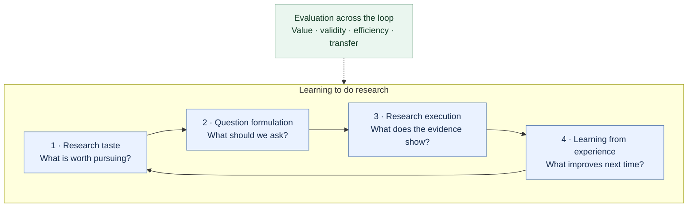
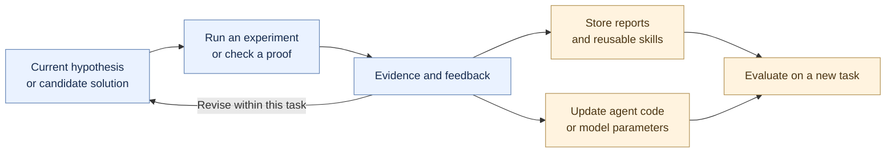

<!-- Generated by scripts/build.mjs from this template and data/*.json. -->
# Awesome Autoresearch: Learning to Do Research

[English](README.md) | [简体中文](README.zh-CN.md)

**Survey paper:** [English PDF](output/pdf/autoresearch-survey-en.pdf) · [中文 PDF](output/pdf/autoresearch-survey-zh.pdf) · [Editable LaTeX](survey/) · [Source ZIP](output/autoresearch-survey-latex.zip)

**How can AI choose worthwhile questions, investigate them rigorously, and become a better researcher through experience?**

A curated collection on **research taste, question formulation, scientific reasoning, and learning from research experience**, with benchmarks, implementations, and researcher essays.

**{{COUNT}} resources · {{PAPER_COUNT}} paper records · {{ESSAY_COUNT}} essays and talks · {{CODE_COUNT}} official code links**

Sources reviewed: {{REVIEW_RANGE}}. A selective collection, not a performance ranking.

## Scope

The **research process itself** is the object of study. AI research is the primary experimental setting; mathematics is a complementary testbed. Work from other disciplines belongs here when it contributes a reusable method or evaluation of how research is done.

We use *autoresearch* broadly: human–AI collaboration, individual research capabilities, and autonomous research systems. It includes, but is not limited to, Karpathy's project. General writing tools, search products, and domain predictors need a specific contribution to the research questions below to qualify.

## Research map

Four capabilities form a feedback loop. Evaluation asks whether each improves; integrated AI scientist systems combine them in practice. The arrows show relationships, not a required pipeline.

{{MAP}}

[Research opportunities](#research-opportunities) · [Learning mechanisms](#learning-mechanisms) · [Choosing a testbed](#choosing-a-testbed) · [Reading paths](#reading-paths)

{{CATALOG}}

## Promising research questions

These are editorial research hypotheses inspired by the collection. They are starting points for experiments, not claims of unoccupied research territory.

| Research question | A useful comparison | What to measure |
| --- | --- | --- |
| Can AI learn taste from outcomes? | Reviewer or citation rewards vs. executed investigations, including informative failures | Selection quality on new topics; value learned per unit of research budget. Start with [AI Can Learn Scientific Taste](#work-ai-can-learn-scientific-taste) and [TasteVal](#work-tasteval). |
| Can question generation anticipate execution? | A proposal alone vs. a proposal with a discriminating experiment and failure criteria | Proposal ratings alongside actual findings. Pair [IdeaSynth](#work-ideasynth) with [The Ideation-Execution Gap](#work-ideation-execution-gap). |
| Which research experience transfers? | Reports, reusable skills, agent-code changes, and parameter training under matched budgets | Improvement on held-out tasks, including cost of collecting experience. Compare [ResearchTrails](#work-researchtrails), [EvoScientist](#work-evoscientist), and [Evolution Fine-Tuning](#work-evolution-fine-tuning). |
| Can evaluation resist style and leakage? | Blinded review, evidence-grounded novelty checks, and executable validation | Sensitivity to wording, retrieval coverage, knowledge cutoffs, and trivial question selection. See [SciStyleBench](#work-scistylebench), [OpenNovelty](#work-opennovelty), and [HindSight](#work-hindsight). |
| Does an agent learn from negative results? | Performance-driven search vs. experiments chosen to distinguish hypotheses | Information gain, calibrated uncertainty, stopping decisions, and robustness of conclusions. See [DAD](#work-deep-adaptive-design), [POPPER](#work-popper), and [Many AI Analysts](#work-many-ai-analysts-one-dataset). |

## What changes when a researcher learns?

Improving a candidate solution and improving the researcher are separate experimental targets. This map distinguishes mechanisms; a system may implement several, and transfer must be tested.

| Mechanism | What changes? | Representative starting points |
| --- | --- | --- |
| Within-task search | Candidate solutions and action choices during one investigation | [AIDE](#work-aide), [OR-Agent](#work-or-agent) |
| Memory and reusable experience | External reports, lessons, or skills available to later runs | [AgentRxiv](#work-agentrxiv), [EvoScientist](#work-evoscientist), [AutoResearchClaw](#work-autoresearchclaw) |
| Agent-program adaptation | The code or strategy controlling the research loop | [ADAS](#work-adas), [Bilevel Autoresearch](#work-bilevel-autoresearch) |
| Parameter training | Model weights, trained before or during an investigation | [MLE-Ideator](#work-mle-ideator), [TTT-Discover](#work-ttt-discover), [Evolution Fine-Tuning](#work-evolution-fine-tuning) |

## Choosing experimental settings

| If you want to study… | Start with… | Add an evaluation of… |
| --- | --- | --- |
| ML experimentation and optimization | [MLE-bench](#work-mle-bench), [MLGym](#work-mlgym), [autoresearch](#work-autoresearch) | Originality and importance of the chosen question |
| Reproduction and scientific coding | [PaperBench](#work-paperbench), [CORE-Bench](#work-core-bench), [SciCode](#work-scicode) | New contributions beyond supplied papers and tasks |
| Question formation and research proposals | [IdeaBench](#work-ideabench), [MLR-Bench](#work-mlr-bench) | Executed outcomes, independent novelty checks, and judge calibration |
| Experimental decisions and research strategy | [TasteVal](#work-tasteval), [FML-bench](#work-fml-bench), [DiscoveryWorld](#work-discoveryworld) | Transfer and the value of the original research agenda |
| Mathematical reasoning and discovery | [FunSearch](#work-funsearch), [AlphaEvolve](#work-alphaevolve), [Aletheia](#work-aletheia), [FrontierMath](#work-frontiermath) | Significance and verification type: numerical, human, or formal |

For a fair comparison, fix model access, data splits, tools, and compute budgets. Report what the human supplies, what the agent chooses, how conclusions are checked, and what survives between runs. Check each resource's scope notes for access, version, and maintenance limits.

## Surveys and communities

- [AutoResearch AI: Towards AI-Powered Research Automation for Scientific Discovery](https://arxiv.org/abs/2605.23204) — workflow overview and terminology.
- [AI for Meta-Science](https://ai4metascience.org/) — research evaluation, reproducibility, and the organization of science.
- [AI for Science community](https://ai4sciencecommunity.github.io/) — scientific discovery, AI scientists, and workshops.

## Contributing

See [CONTRIBUTING.md](CONTRIBUTING.md) for inclusion criteria, source verification, and bilingual updates. The [catalog](data/) stores full metadata and review dates; both READMEs are generated from it. Original repository materials use the [MIT License](LICENSE); linked resources retain their own licenses.

## Suggested reading paths

Choose the question closest to your interests. The order highlights complementary evidence and mechanisms, rather than ranking systems.

{{STARTER}}

For a complete implementation, continue with [The AI Scientist-v2](#work-ai-scientist-v2) or [AI-Researcher](#work-ai-researcher). For the broader research-method perspective, pair [Hamming](#work-hamming-you-and-your-research) with [Nielsen's research heuristics](#work-nielsen-research-heuristics) and [Research Debt](#work-research-debt).
