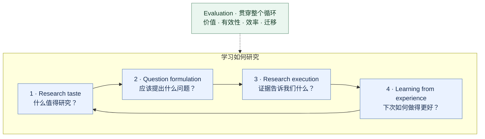
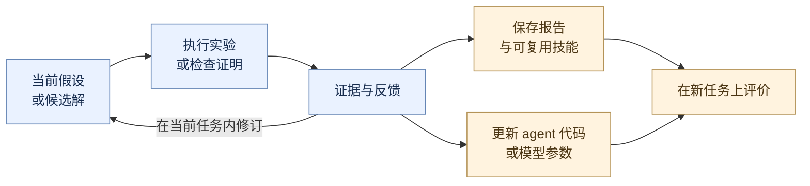

<!-- Generated by scripts/build.mjs from this template and data/*.json. -->
# Awesome Autoresearch: Learning to Do Research

[English](README.md) | [简体中文](README.zh-CN.md)

**如何让 AI 选择值得研究的问题，严谨地开展研究，并通过经验成为更好的研究者？**

围绕 **research taste、question formulation、scientific reasoning 与 learning from research experience** 整理的精选资源，涵盖论文、基准、实现与研究者文章。

**{{COUNT}} 项资源 · {{PAPER_COUNT}} 篇论文记录 · {{ESSAY_COUNT}} 篇文章与演讲 · {{CODE_COUNT}} 个官方代码链接**

来源核查日期：{{REVIEW_RANGE}}。这是一份精选集合，不是性能排行榜。

## 研究范围

我们研究的对象是**研究过程本身**。以 AI research 为主要实验场景，数学为补充 testbed；其他学科的工作若提供可复用的科研方法或评价协议，也在收录范围内。

这里的 *autoresearch* 包括人机协作、单项科研能力以及自主科研系统，也包含 Karpathy 的项目。写作工具、检索产品和领域预测模型，需要对下述研究问题有具体的方法贡献，才符合收录范围。

## 研究地图 · Research map

四项能力构成反馈循环，evaluation 贯穿其中；完整 AI scientist systems 将它们组合成实际流程。箭头表示能力之间的联系，不代表必须遵循的固定顺序。

{{MAP}}

[研究机会](#research-opportunities) · [学习机制](#learning-mechanisms) · [实验场景](#choosing-a-testbed) · [阅读路线](#reading-paths)

{{CATALOG}}

## 值得探索的研究问题

以下是从集合中提炼的研究设想，可作为实验起点；并不表示这些问题尚无人研究。

| 研究问题 | 可以比较什么？ | 评价什么？ |
| --- | --- | --- |
| AI 能否从研究结果中学到 taste？ | 评审或引用奖励，与真实执行后的反馈（包括有信息量的失败） | 新领域的选题质量、单位研究预算获得的知识价值。参考 [AI Can Learn Scientific Taste](#work-ai-can-learn-scientific-taste) 与 [TasteVal](#work-tasteval)。 |
| 提问时能否预判如何验证？ | 只有 proposal，与同时提供区分性实验及失败判据的 proposal | 并列报告提案评分和实际发现。结合 [IdeaSynth](#work-ideasynth) 与 [The Ideation-Execution Gap](#work-ideation-execution-gap)。 |
| 哪些研究经验能够迁移？ | 相同预算下的报告记忆、可复用技能、agent 代码修改与参数训练 | 留出任务上的提升，并计入经验采集成本。比较 [ResearchTrails](#work-researchtrails)、[EvoScientist](#work-evoscientist) 与 [Evolution Fine-Tuning](#work-evolution-fine-tuning)。 |
| 如何减少文风与泄漏对评价的影响？ | 盲审、基于证据的新颖性检查、可执行验证 | 措辞敏感性、检索覆盖、知识截止日期，以及是否偏好容易验证但价值低的问题。参考 [SciStyleBench](#work-scistylebench)、[OpenNovelty](#work-opennovelty) 与 [HindSight](#work-hindsight)。 |
| Agent 能否从负结果中学到东西？ | 优化性能的搜索，与用于区分假设的实验 | 信息增益、不确定性校准、停止决策与结论稳健性。参考 [DAD](#work-deep-adaptive-design)、[POPPER](#work-popper) 与 [Many AI Analysts](#work-many-ai-analysts-one-dataset)。 |

## 研究者学习时，究竟改变了什么？

改善候选解与改善研究者，是不同的实验目标。下面区分学习机制；一个系统可以同时采用多种机制，迁移效果需要另行检验。

| 机制 | 改变了什么？ | 代表性起点 |
| --- | --- | --- |
| Within-task search | 一次研究中的候选解和行动选择 | [AIDE](#work-aide)、[OR-Agent](#work-or-agent) |
| Memory / reusable experience | 后续研究可读取的外部报告、经验和技能 | [AgentRxiv](#work-agentrxiv)、[EvoScientist](#work-evoscientist)、[AutoResearchClaw](#work-autoresearchclaw) |
| Agent-program adaptation | 控制科研循环的代码或策略 | [ADAS](#work-adas)、[Bilevel Autoresearch](#work-bilevel-autoresearch) |
| Parameter training | 在研究前或研究过程中训练的模型权重 | [MLE-Ideator](#work-mle-ideator)、[TTT-Discover](#work-ttt-discover)、[Evolution Fine-Tuning](#work-evolution-fine-tuning) |

## 如何选择实验场景

| 想研究什么？ | 可以从哪里开始？ | 还需要补充什么评价？ |
| --- | --- | --- |
| ML 实验与优化 | [MLE-bench](#work-mle-bench)、[MLGym](#work-mlgym)、[autoresearch](#work-autoresearch) | 所选问题的原创性和重要性 |
| 复现与科学编程 | [PaperBench](#work-paperbench)、[CORE-Bench](#work-core-bench)、[SciCode](#work-scicode) | 超出给定论文和任务的新贡献 |
| 问题形成与研究提案 | [IdeaBench](#work-ideabench)、[MLR-Bench](#work-mlr-bench) | 实际执行结果、独立新颖性检查和评审校准 |
| 实验决策与科研策略 | [TasteVal](#work-tasteval)、[FML-bench](#work-fml-bench)、[DiscoveryWorld](#work-discoveryworld) | 迁移能力与原始研究议程的价值 |
| 数学推理与发现 | [FunSearch](#work-funsearch)、[AlphaEvolve](#work-alphaevolve)、[Aletheia](#work-aletheia)、[FrontierMath](#work-frontiermath) | 数学意义与验证类型：数值、人类或形式化 |

公平比较需要固定模型访问、数据划分、工具和计算预算。分别报告人类提供了什么、agent 决定了什么、结论如何验证，以及哪些经验保留到了后续研究。资源的开放范围、版本和维护限制见各节可展开的说明。

## 综述与社区

- [AutoResearch AI: Towards AI-Powered Research Automation for Scientific Discovery](https://arxiv.org/abs/2605.23204) — 科研流程概览与术语参考。
- [AI for Meta-Science](https://ai4metascience.org/) — 科研评价、可复现性与科学组织方式。
- [AI for Science community](https://ai4sciencecommunity.github.io/) — 科学发现、AI scientists 与相关 workshops。

## 参与贡献

[CONTRIBUTING.md](CONTRIBUTING.md) 说明了收录标准、来源核查与双语更新方式。[目录数据](data/) 保存完整元数据和核查日期，两份 README 由它统一生成。仓库原创内容使用 [MIT License](LICENSE)，链接资源保留各自许可证。

## 建议阅读路线 · Suggested reading paths

从最感兴趣的问题出发。排序强调证据和机制之间的互补关系，不是系统排名。

{{STARTER}}

想了解完整实现，可继续读 [The AI Scientist-v2](#work-ai-scientist-v2) 或 [AI-Researcher](#work-ai-researcher)。想从更广泛的科研方法视角思考，可结合 [Hamming](#work-hamming-you-and-your-research)、[Nielsen 的研究启发](#work-nielsen-research-heuristics) 与 [Research Debt](#work-research-debt)。
